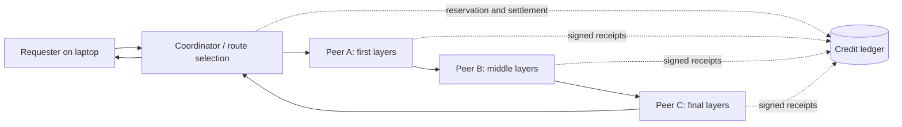
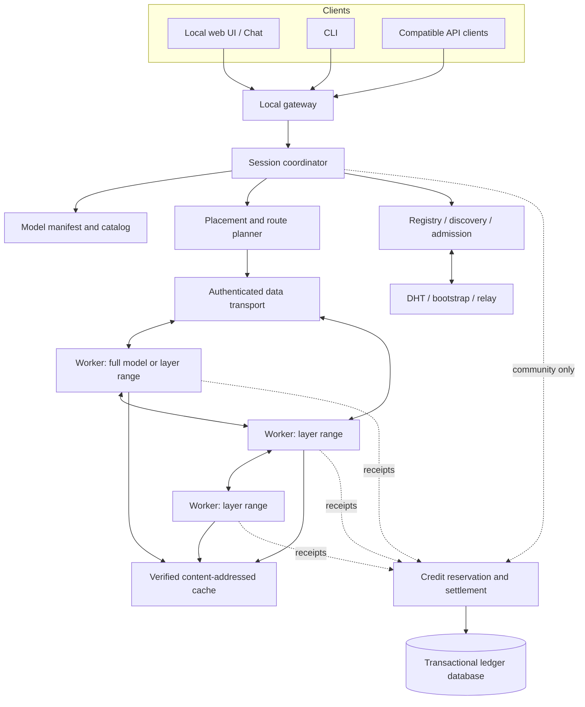
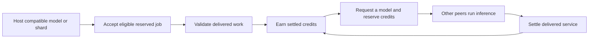
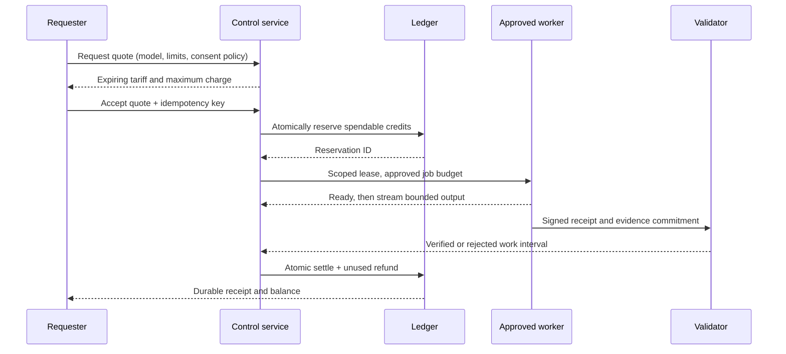

> **Execution note:** This is the approved v2 planning baseline. Statements below about actions not yet authorized describe the original planning session. The owner has now authorized implementation. Acceptance still requires the stated evidence; proposed PR IDs are work-package IDs, not GitHub pull request numbers. See [implementation status](IMPLEMENTATION_STATUS.md).

# SYNAPSE — Master product and engineering plan v2.0

**Working tagline:** Your devices. One AI.
**Product concept:** BitTorrent-style cooperative inference for open-weight AI models.
**Status:** Proposed roadmap; existing repository is an experimental implementation, not a validated public network.
**Prepared / expanded:** 25 November 2026
**Planning version:** v2.0 — 28 sections, 56 proposed PRs; supplements §§17–28 define implementation contracts and additional gates.
**Repository:** [0xQuerencia/synapse](https://github.com/0xQuerencia/synapse)
**Reviewed baseline:** [`1785da5b5f1f87ac6ec008a022ebd68ee22be7cc`](https://github.com/0xQuerencia/synapse/commit/1785da5b5f1f87ac6ec008a022ebd68ee22be7cc)
**Suggested destination in repo:** `docs/MASTER_PLAN.md` (not yet committed).

> **North star:** Install Synapse, join a compute network, contribute spare resources when you choose, and use earned credits to run open-weight AI models on other participants' computers — even when your own computer cannot fit the model and the other devices are in another city or country.

This document specifies a proposed product, its architecture, research references, implementation sequence, acceptance criteria, credits system, security model, and future landing page. Read §§1–16 for the original roadmap and §§17–28 for implementation-level contracts, expanded economics, operations, testing and 18 additional PRs. If original milestone ordering differs from §28, the supplemental dependency gates take precedence. It is an execution plan, not a claim that the features are already implemented. No PRs, issues, files, releases, deployments, accounts or GitHub settings have been changed by this review.

## Contents

1. [Product vision and boundaries](#1-product-vision-and-boundaries)
2. [Mental model and user journeys](#2-mental-model-and-user-journeys)
3. [Current repository audit and runnable baseline](#3-current-repository-audit-and-runnable-baseline)
4. [Research: what to learn from other projects](#4-research-what-to-learn-from-other-projects)
5. [Target architecture](#5-target-architecture)
6. [Model distribution and execution](#6-model-distribution-and-execution)
7. [Internet-wide discovery and routing](#7-internet-wide-discovery-and-routing)
8. [Credits, incentives and gamification](#8-credits-incentives-and-gamification)
9. [Security, trust, privacy and operations](#9-security-trust-privacy-and-operations)
10. [Product interfaces and API](#10-product-interfaces-and-api)
11. [Milestones and release gates](#11-milestones-and-release-gates)
12. [Complete proposed PR backlog](#12-complete-proposed-pr-backlog)
13. [Benchmark and acceptance plan](#13-benchmark-and-acceptance-plan)
14. [Landing page specification](#14-landing-page-specification)
15. [Decisions, risks and first actions](#15-decisions-risks-and-first-actions)
16. [References and source register](#16-references-and-source-register)
17. [Implementation contract, scope control and source of truth](#17-implementation-contract-scope-control-and-source-of-truth)
18. [Detailed inference and scheduling specification](#18-detailed-inference-and-scheduling-specification)
19. [Protocol, network and interoperability contracts](#19-protocol-network-and-interoperability-contracts)
20. [API, identity, application and configuration specification](#20-api-identity-application-and-configuration-specification)
21. [Worker daemon, session lifecycle and contributor safety](#21-worker-daemon-session-lifecycle-and-contributor-safety)
22. [Credits: complete accounting, incentives and economic simulation](#22-credits-complete-accounting-incentives-and-economic-simulation)
23. [Security, privacy, responsible use and legal launch gates](#23-security-privacy-responsible-use-and-legal-launch-gates)
24. [Infrastructure, deployment, reliability and operating budget](#24-infrastructure-deployment-reliability-and-operating-budget)
25. [Testing, evidence, performance and release engineering](#25-testing-evidence-performance-and-release-engineering)
26. [Complete product UX, website, developer and launch brief](#26-complete-product-ux-website-developer-and-launch-brief)
27. [Research additions, pilot plan and unresolved owner decisions](#27-research-additions-pilot-plan-and-unresolved-owner-decisions)
28. [Supplemental PR backlog, execution dependencies and final go/no-go](#28-supplemental-pr-backlog-execution-dependencies-and-final-gono-go)

---

## 1. Product vision and boundaries

### What Synapse is

Synapse is a distributed runtime and cooperative compute network for running existing AI models. It turns heterogeneous devices into a network that can execute a model locally, across a private cluster, or eventually across a community swarm. A requester can either use their own hardware or request resources supplied by other people. A contributor can choose what resources to share and earn non-monetary credits for useful, verified work.

There are two related but distinct things to decentralize:

- **Model distribution (the torrent analogy):** peers hold and optionally serve verified chunks of model weights. This reduces redundant downloads and makes selected, redistributable model artifacts easier to obtain.
- **Inference (the harder problem):** peers run a whole model or selected transformer layers, processing input and passing activations to the next stage. This is what produces a response. Computation is sequential and stateful in ways that file sharing is not.

A third service — accounting — tracks compute reservations and credits. It does not have to be decentralized at launch. Separate the inference data plane from the membership/credit control plane so a self-hosted private cluster can work without a community account.

### Who this is for

| Audience | Problem | Synapse value |
|---|---|---|
| Student / independent developer | Cannot afford a large accelerator or repeated API bills | Use compatible hardware and, later, verified community compute |
| Homelab owner | Owns several mixed devices but cannot use them as one inference runtime | Model placement and observable resource sharing |
| Contributor | Has idle CPU/GPU capacity but needs control over resource use | Explicit opt-in hosting, usage limits, credits, pause/stop |
| Small team / club | Wants shared AI on trusted infrastructure | Private membership, model catalog and common API |
| Researchers / systems developers | Need repeatable experiments on distributed inference | Reproducible correctness, performance and failure tests |

### Product modes

| Mode | How it works | Trust | Credits | Priority |
|---|---|---|---|---|
| Solo | One machine runs one compatible model | Own machine | None | Baseline |
| Private cluster | Multiple user-owned or explicitly trusted machines over LAN or internet | Invite-only | None by default | First usable release |
| Community pool — full-model hosts | Remote contributors run an entire compatible model; clients route requests to suitable hosts | Approved hosts; explicit data disclosure | Required for community use | First incentivized beta |
| Community pool — sharded | Multiple eligible contributors each serve a subset of model layers | Approved/opt-in pool; higher privacy and integrity risk | Per verified assignment | Later controlled beta |
| Open swarm | Public discovery and broad voluntary contribution | Adversarial; unresolved strong verification/privacy | Experimental | Research, not launch scope |

**Key decision:** public full-model routing and true layer sharding are complementary. If a nearby peer can fit the whole model, one remote request is often faster than serially routing every token across distant machines. If no peer can fit the model, sharding becomes essential. The scheduler should choose the mode, not force the user into the slowest topology.

### Non-goals for the initial releases

- No training or fine-tuning distributed across strangers' computers.
- No mining, blockchain, token sale, speculative currency, staking, tradable tokens, cash redemption, or guaranteed monetary rewards. Credits are closed-loop usage accounting.
- No claims of anonymous, encrypted-from-workers, universally private inference. Transport encryption is not confidentiality from computing peers.
- No arbitrary model repository code execution, custom remote shell commands, agent tools, or execution of code submitted by unknown peers.
- No promises that all models run, adding peers always increases speed, inference is free, or a public swarm is automatically trustworthy.
- No dependence on a hosted dashboard or central credit service for offline private inference.
- No premature rewrite into six unrelated frameworks or premature browser/mobile/GPU support claims.

### Primary success criterion

A new user can reproduce an inference session across two machines with measured per-node memory limits, run a model that does not fit into either machine's configured inference memory budget, and inspect evidence of which layers ran where. A later community release must additionally prove credit conservation, fair settlement, safe participation and a reliable inter-city internet connection. Performance and usability must be measured rather than advertised in advance.

---

## 2. Mental model and user journeys

### A concrete example

Suppose a user in Ahmedabad has a lightweight laptop and a friend in another city has an idle desktop GPU. The user wants to run an open-weight model. The app discovers compatible, trusted contributors, measures the network and checks memory budgets. If the desktop can run the whole model, the app may use it as the sole remote inference host. Otherwise it finds a contiguous chain of shards whose combined coverage is the entire model. Each assigned device loads the subset it needs and reports readiness. The requester sends a prompt, receives streaming output and spends credits only for the service delivered under a published tariff. Contributors earn credits for validated work, not just for saying they are online.



The diagram is a target architecture. The early prototype routes activations through the host; direct peer forwarding is a later optimization. Depending on backend placement, tokenization, embedding, final normalization and sampling can occur at different trusted nodes; the route must make each role explicit.

### Journeys

**Request AI:** install/open Synapse → choose Solo, Private or Community → choose a supported model → see estimated resource fit and credit quote (community only) → review privacy warning if using external peers → reserve a bounded job → stream response → receive usage receipt and remaining balance. Cancellation must release unused reserved credits and stop compute at a defined boundary.

**Contribute compute:** install signed native worker → create/import device identity → choose a pool and approve membership → profile hardware → select maximum memory, CPU/GPU utilization, bandwidth, storage, battery/temperature policy and availability schedule → download approved weights/shards → mark ready → serve only authorized jobs → see verified receipts, pending credits, earnings, actual utilization and a prominent pause/stop control.

**Private cluster:** create a local cluster → share one-time invite → pair two devices → view available models and topology → run a local or distributed session. No mandatory cloud login, account or credit service. Internet private groups may use hosted or self-hosted bootstrap/relay infrastructure.

**Contributor becomes requester:** when not providing compute, spend the same account's credits on eligible jobs from others. A user's own offline machine need not be running to use previously earned community credits; their requester must still reach the network and there must be eligible capacity. If no route is available, queue within a published timeout or reject without charging.

### What a model, shard and token mean

- A model consists of weights plus configuration, tokenizer, model architecture and a compatible execution format.
- A shard is a declared contiguous set of layers and required associated tensors, not a randomly split binary file.
- A token is a unit of model input/output. Generating the next token requires a forward pass across the necessary model layers. Prefill handles the prompt; decoding generates subsequent tokens. KV cache stores intermediate attention state per session.
- A peer may cache weights without executing jobs. A compute peer advertises actual ready model ranges and capacity. Relays only forward encrypted traffic; do not confuse them with inference workers.

---

## 3. Current repository audit and runnable baseline

### Existing foundation

The reviewed Rust workspace contains `synapse-core`, `synapse-cli` and `synapse-gui`; Candle inference primitives; libp2p QUIC/TCP networking; mDNS, DHT, relay and pairing code; sharded model loader primitives; static and hardware-aware planners; KV cache, compression, speculative-decoding and route-replay code; CLI `host`, `join`, `demo`, `connect` and `relay`; a local GUI; tests and scripts. These are code-presence observations, not verified functional claims. The older detailed overview and the current README disagree on WAN scope and fallback behavior.

### Baseline findings to reproduce and fix

| ID | Priority | Static finding / evidence | Required resolution |
|---|---|---|---|
| B01 | P0 | `network/node/lifecycle.rs`: `Master` loads the full layer span, and `Worker` initializes with `total..total`. No demonstrated ready-shard lifecycle. | Negotiate explicit placement before loading; no hidden full host load; worker acknowledgment of resident layers. |
| B02 | P0 | `network/node/generation.rs`: capability-aware path plans `total_layers` for workers and then shifts them by a host prefix. Planner may exceed model depth. | One authoritative plan with exact contiguous coverage and validated memory budgets; property tests. |
| B03 | P0 | `inference/model_loader.rs`: multi-file safetensors `weight_map.keys()` appear to be tensor names rather than the mapped filenames. | Parse values, deduplicate valid paths, validate and hash manifest files. Add offline fixture. |
| B04 | P0 | Latest returned main CI at reviewed SHA failed; all four returned CI runs failed. | Inspect failing jobs, repair, publish successful runs; no bypasses. [CI run](https://github.com/0xQuerencia/synapse/actions/runs/32949751902). |
| B05 | P1 | `scripts/demo_two_nodes.sh` uses old binary `synapse-cli`; actual binary name is `synapse`. Same-host processes need separate identities. | One reliable script with fixed ports, deadlines, log capture, separate identities and verified completed output. |
| B06 | P1 | `scripts/benchmark_latency.sh` divides elapsed wall time (including startup) by assumed 50 tokens and calls it a p95 goal; log directory is removed in cleanup. | Actual timestamps, output counts, percentiles and persisted JSON/CSV. |
| B07 | P1 | CLI host wraps prompts using SmolLM2-specific format; model loading supports a limited architecture despite broad README language. | Explicit model families, model-specific templates, deterministic reference parity and compatibility matrix. |
| B08 | P1 | GUI's Ollama option is local-only, with no swarm. GUI exposes config mutation; default loopback must remain protected against unintended access. | Label solo backend, authenticate all privileged actions, tighten CORS/origin/CSRF, avoid tokens in logs/URLs. |
| B09 | P1 | Root `LICENSE` is MIT while workspace metadata says Apache-2.0. | Owner chooses intended license; audit existing rights, harmonize metadata; preserve third-party notices. |
| B10 | P1 | Model file hash verification does not yet establish a signed manifest with every shard/revision verified; downloader currently fetches whole checkpoints. | Pin revision and verify each authorized artifact, fetch only required tensors/files where feasible. |
| B11 | P2 | No published installable GitHub releases found in earlier review; docs mismatch code. | Reproducible packages, checksums/signatures, smoke test and quickstart. |

Source paths and reviewed links are collected in §16. The first PR must reproduce failures on the pinned baseline and update this list if static analysis is wrong. Do not treat a source comment or passing build as evidence of usable distributed inference.

### How to run the baseline (not yet validated)

Prerequisites: Git, Rust 1.94+ (as declared by workspace), native compiler/linker tools for your platform, access to Hugging Face for initial weights, enough disk/memory, two trusted machines for networking. Start with Linux CPU. The exact dependency packages will be documented and tested in the first PR.

```bash
git clone https://github.com/0xQuerencia/synapse.git
cd synapse
git checkout 1785da5b5f1f87ac6ec008a022ebd68ee22be7cc
rustup update stable
cargo build --release --locked --bin synapse
./target/release/synapse --help
```

First try the tiny model, which tests mechanics but produces meaningless text because it has random weights:

```bash
./target/release/synapse demo \
  --model hf-internal-testing/tiny-random-LlamaForCausalLM \
  --prompt "Hello" --max-tokens 8
```

Then try the real small model (the demo uses a raw prompt; the existing interactive host applies a SmolLM2 template):

```bash
./target/release/synapse demo \
  --model HuggingFaceTB/SmolLM2-135M-Instruct \
  --prompt "Once upon a time" --max-tokens 32
```

Two-device experiment on the same trusted LAN, with the CLI built on both computers:

```bash
# Host: note the displayed pairing code. Do not expose this port publicly.
./target/release/synapse host --master \
  --model HuggingFaceTB/SmolLM2-135M-Instruct \
  --listen 0.0.0.0:34001 --max-tokens 32

# Worker: replace the example IP address and code with the host's actual values.
./target/release/synapse join 192.168.1.10:34001 \
  --model HuggingFaceTB/SmolLM2-135M-Instruct --code YOUR_PAIRING_CODE
```

On a single machine use distinct `--identity-path` files for each process and use `127.0.0.1:34001` instead. Avoid opening firewall ports beyond the trusted test network. The host waits for a worker before its interactive session. Press Ctrl+C to stop. Record complete logs and actual errors before debugging.

```bash
# Existing local web GUI, if compilation succeeds.
cargo run --release --locked -p synapse-gui
# Open http://127.0.0.1:8080 in your own browser.
```

Keep the GUI on loopback, not a public tunnel. The existing Ollama backend is not distributed. CI is not green at the pinned baseline, so these are source-derived commands, not a successful run report. A core goal of PR-01 through PR-08 is turning them into a reliable, documented workflow.

---

## 4. Research: what to learn from other projects

Research reviewed public upstream README, selected architecture/configuration source, release notes and papers. Claims below are attributed upstream capabilities, not independently reproduced results. Before copying or depending on code, pin the exact upstream commit, review dependency/model licenses, add provenance and notices. Prefer design ideas and independent Rust implementations when possible. Do not copy another project's brand, assets or claims.

| Project | Architectural lesson | Apply to Synapse | Do not blindly copy |
|---|---|---|---|
| [EXO](https://github.com/exo-explore/exo) [R1] | Automatic discovery, placement informed by network topology and resource availability; model instance lifecycle, API compatibility and dashboard. Current MLX/RDMA-oriented backend. | Separate coordinator from workers; route using measured links; add readiness events and explicit instance lifecycle. Provide a simple model selector and familiar API. | Thunderbolt/RDMA performance claims do not transfer to WAN or mixed CPU/GPU nodes. Do not replace Rust with EXO wholesale. |
| [Petals](https://github.com/bigscience-workshop/petals) [R2–R4] | The closest precedent to BitTorrent-like inference. Peers serve transformer block ranges; DHT discovery, route choice, cache capacity and failure handling; release notes describe direct server-to-server activations. | Adopt signed, expiring block availability records; choose a complete route with latency/compute/cache constraints; maintain replicas and bounded retries. Learn from private allowlists. | Internet volunteers do not guarantee confidentiality or correct outputs. Do not equate successful Petals benchmarks to Synapse performance. |
| [Prima.cpp](https://github.com/OpenCPIL/prima.cpp) [R5] | Heterogeneity-aware allocation, memory mapping, disk prefetch, CPU/GPU offload and piped-ring execution for home clusters. | Use model-specific resident bytes, memory bandwidth, compute and link profiling. Benchmark memory-saving loading first; later test disk prefetch and mixed backend. | Do not start with complicated piped-ring/disk optimizations before correctness. Scope claims to tested devices and networks. |
| [Distributed Llama](https://github.com/b4rtaz/distributed-llama) [R6] | Cross-platform distributed inference with tensor parallelism and high-speed synchronization on Ethernet. | Learn from quantized formats, hardware-specific kernels and published configurations; consider tensor parallelism only for measured fast LAN interconnects. | Repeated collectives are a poor default for distant Wi-Fi-connected peers. No claim that additional devices always speed up inference. |
| [llama.cpp](https://github.com/ggml-org/llama.cpp) [R7–R8] | Mature GGUF ecosystem and optimized inference backends, with API server and experimental remote device RPC. | Evaluate a local backend adapter for full-model hosting and use a pinned reference implementation for correctness/performance. Study its hardware support and model handling. | RPC documentation explicitly warns against open networks. Never expose raw RPC as the community protocol; use authenticated, narrowly defined Synapse messages. |
| [tejasphatak/Synapse](https://github.com/tejasphatak/Synapse) [R9] | Separate project with same name: coordinator, browser WebGPU workers, sharded weights, IndexedDB caching and QR onboarding. README documents phone demonstrations and marks several optimizations as validation-stage. | Later browser PWA experiment: signed manifest, user consent, worker tab lifecycle, local resource cap, QR pairing and measured compression. | A browser is not a dependable always-on native daemon. Do not copy name/branding or quote targets as achieved throughput. |
| [BOINC](https://github.com/BOINC/boinc/wiki/How-BOINC-works) [R10] | Volunteer computing credits distinguish claimed and granted work; projects can compare independently computed results. | Separate pending/settled credit, challenge and audit work, reject invalid or duplicated receipts. | LLM streaming is latency-sensitive and cross-backend floating-point results may differ. Replication is costly; use selective verification, not indiscriminate duplicate inference. |

### Research-to-implementation traceability

| Lesson | Synapse PRs |
|---|---|
| EXO placement and topology / model readiness | PR-07, 10, 12, 18, 25 |
| Petals block advertisement, routing, WAN recovery | PR-11, 13–17, 19, 23 |
| Prima.cpp model-aware memory and heterogeneous scheduling | PR-03, 05, 10, 12, 26 |
| Distributed Llama LAN benchmark and optional tensor parallelism | PR-09, 26, 35 |
| llama.cpp GGUF, local host adapter and safe API boundary | PR-04, 20, 21, 26 |
| Browser Synapse contributor UX and WebGPU | PR-25, 30, 36 |
| BOINC earned-credit verification | PR-22–24, 27, 28 |
| libp2p NAT traversal and relay quotas [R11] | PR-13–16, 29 |
| Split-inference prompt reconstruction research [R12] | PR-17, 19, 22, 27, 32 |

### Licensing decisions

EXO's top-level license is Apache-2.0 [R13]; Petals, Distributed Llama, llama.cpp and the browser Synapse report MIT [R4, R6, R8, R9]; Prima's project site reports MIT [R5]. Verify licenses at the actual imported commit, including vendored and nested assets, and independently verify each model license. Publicly downloadable weights are not automatically redistributable or usable for a hosted service. Do not advertise an unreviewed model catalog.

For each direct import create `docs/upstream-provenance.md` entry: upstream URL, exact commit, copied files/functions, license, modifications, required notices, and reviewer. The root/Cargo mismatch must be resolved by the owner before external imports. The proposed default is retain existing MIT if the owner confirms rights, but meet all obligations for incorporated Apache-licensed components; do not relicense existing contributions without authority. Record the name collision and investigate naming/trademark before public branding. No rename required to start.

---

## 5. Target architecture



### Separation of responsibilities

| Subsystem | Responsibility and boundary |
|---|---|
| Local gateway | Own chat/API auth, limits, consent, cancellation, streaming and local-only operation. Never require a credit account for solo/private mode. |
| Coordinator | Choose request-scoped model identity and route epoch, negotiate placement, reserve capacity, wait for readiness, oversee session and recovery. Does not need to store all model weights. |
| Model registry | Versioned supported manifest, license/redistribution policy, exact artifact hashes, tokenizer/config hashes, format, architecture, quantization, memory estimates. |
| Device registry | Peer identities, pool membership, measured resources, runtime/backend compatibility, trust/reputation, expiry. Do not treat advertisements as authoritative billing claims. |
| Scheduler | Complete contiguous coverage, actual memory/compute limits, link costs, cache availability, queue and reliability; choose full-model host, layer chain, local or reject. |
| Native worker | Explicit opt-in daemon, verified weights, safe inference operations, per-session caches, resource budgets, signed work receipts, heartbeat, pause/drain. |
| Data transport | Peer-authenticated encrypted control/data streams, bounded messages, direct route or rate-limited relay, ordered steps, backpressure. |
| Model cache | Local validated artifact storage; optional peer-served immutable chunks after license review. No arbitrary URL fetching by peers. |
| Community control service | Account/device enrollment, approved pool and model policies, admission, quotes, reservations, abuse controls. Central authority initially; distinct from peer-to-peer compute. |
| Credit ledger | Atomic double-entry accounting, idempotency, reservation expiry, validation and reconciliation. Authoritative server-side only. |
| Observability | Local diagnostics, opt-in aggregate metrics, route trace, actual peer memory and latencies; no prompt/activation logging. |

### Proposed code organization

Keep existing crates, refactor incrementally. Proposed new modules and crates below are design targets, not files already present.

```text
crates/
  synapse-core/          # existing; inference contracts, protocol, placement
  synapse-cli/           # existing; operator and worker UX
  synapse-gui/           # existing; local dashboard
  synapse-worker/        # extract native daemon after core correctness
  synapse-gateway/       # API-facing service; can initially live in GUI crate
  synapse-control/       # optional hosted community membership / scheduling
  synapse-ledger/        # settlement domain logic and repository interface
  synapse-bench/         # timestamped, machine-readable benchmark harness
web/landing/            # separate public landing page; no worker admin UI
infra/                  # deployment configs for bootstrap, relay, control, DB
  local/                # docker compose or equivalent reproducible test env
  staging/
docs/
  adr/                  # architecture decision records
  protocols/            # versioned protocol and message contracts
  security/             # threat model, reporting, trust tiers
  benchmarks/           # published methodology and immutable run artifacts
  upstream-provenance.md
```

Do not move modules purely for aesthetics. Use interfaces in the existing code until a separation is justified. Rust/Candle/libp2p stay for initial milestones. PostgreSQL is proposed for the hosted ledger (transactions, unique constraints, reconciliation); private/local config can remain local. A daemon can use a local store for cached weights and device settings. Select actual implementation frameworks and hosting providers in ADRs after requirements are validated.

---

## 6. Model distribution and execution

### Model manifest

Each supported model has an immutable identity consisting of model family, upstream repository/revision, format/quantization and a manifest digest. Include approved redistribution/hosting rights, tokenizer/config checksums, exact ordered layer count, required non-layer tensors, file sizes/hashes, shard-to-tensor mapping, dtype/shape, context limits, backend compatibility, and per-range measured memory characteristics. The model registry can sign reviewed manifests; verified files are immutable. Workers reject mismatched manifests, unknown shapes, unsupported backends and revisions. Do not trust a bare model name.

### Correct placement before loading

1. Enumerate supported local backends and real free resources; reserve headroom for OS, KV cache, scratch buffers, tokenizer/embedding/head and active sessions.
2. Construct candidate placements. For sharded inference, every layer must be executed exactly once in order, with no gaps or overlaps; model input and output roles must be assigned explicitly.
3. Check memory independently per device and backend. Aggregate capacity is necessary but not sufficient. For an initial host-prefix design, allocate workers only the remainder, never the whole model plus the prefix.
4. Send a signed assignment with model digest, layer range, route epoch, lease and resource limit. Load only assigned layers (non-layer tensors only where needed). A worker must prove readiness by validated range and test challenge.
5. Commit a route only when all necessary stages are ready. If any stage fails, cancel allocations, try another bounded candidate or reject the request.
6. Keep session KV cache bound to model, route epoch, request and token position. Reuse only within an authenticated compatible session. Replanning requires explicit state reconstruction or a clean failure.

Use the following planning model instead of a fixed 50 MB/layer heuristic:

```text
required_memory(node, range, context, batch) =
    assigned_weight_bytes
  + required_non_layer_weights
  + kv_cache_bytes(context, batch, assigned_layers)
  + runtime_scratch_bytes + allocator_headroom
```

Account for RAM and VRAM separately, shared memory where applicable, actual backend allocation and measured resident memory. Do not silently fall back to loading the whole model on a device that cannot fit it.

### Execution choices

- **Full-model remote hosting:** one eligible peer loads a complete model and streams tokens; bandwidth mostly text/protocol overhead. This is often best across a slow WAN when a suitable peer exists. It still has privacy and integrity risks.
- **Pipeline/model-layer parallelism:** contiguous ranges, per-token ordered forward pass, session-local KV. Prioritize low-crossing routes, preferably nearby peers or a fast local subcluster.
- **Tensor parallelism:** split each layer's operations and synchronize across devices. Consider only after measuring interconnect speed and correctness; optional fast-LAN backend, not WAN default.
- **Replica/request parallelism:** different users or independent requests routed to separate complete instances; increases throughput and availability, not necessarily speed of a single response.

### Model weights: seed/cache vs run

Start with approved model artifacts fetched from canonical Hugging Face sources at pinned revisions. Fix safetensors filename resolution and use exact checksums. Build shard selection/loading before attempting P2P file distribution. For GGUF monoliths, memory mapping can reduce resident memory but a complete file download may still consume disk and bandwidth; be honest about that distinction. For safetensors multi-file layouts, fetch only files needed by assigned tensors where possible; create model-specific shard manifests for redistribution when licensed.

Later add optional content-addressed chunk serving with SHA-256 or equivalent reviewed digest, signed manifest, bounded chunk size, disk quotas, download progress, resumability, peer/source backoff, final integrity verification, canonical-origin fallback, LRU eviction and license allowlist. Do not use BitTorrent's network directly or support arbitrary torrents by default. This can use libp2p streams; actual peer weight caching is optional and independent of inference execution.

No credits for blindly downloading, storing, or seeding files. If measured bandwidth scarcity justifies it, later pilot a separate capped, verified delivery reward with a funded budget. No unlicensed or gated artifact redistribution.

---

## 7. Internet-wide discovery and routing

### Wi-Fi is not the same as WAN

Synapse should work whether a device accesses the network through Wi-Fi or Ethernet. Wi-Fi is the local link to the router; the internet is what connects devices thousands of kilometers apart. A remote worker in another city does not need to be on the same Wi-Fi. mDNS discovery only serves the local broadcast domain and cannot find arbitrary remote computers. A public bootstrap/relay or an explicitly configured remote address is required for ordinary home networks. Many peers sit behind NAT, carrier-grade NAT or firewalls; direct connections cannot be guaranteed.

### Network plan

1. **LAN:** mDNS, authenticated one-time invite, explicit manual address fallback, per-cluster isolation.
2. **WAN control:** invite-only pool directory and signed, expiring availability records (PeerId, manifest digest, ranges, free capacity bucket, supported backend, reachable addresses, timestamp, signature); bootstrap nodes help find peers; DHT for discovery hints, not trust or settlement. No sensitive prompts or balances in the DHT. Avoid public disclosure of precise location; use coarse regions and measured latency.
3. **NAT traversal:** libp2p Identify, AutoNAT, Circuit Relay v2, DCUtR/hole punching; prefer direct authenticated QUIC when possible and test TCP fallback. If punching fails, use capacity-limited relay with expiring reservations. Avoid asking everyday users to port-forward arbitrary services. Relays should see encrypted peer traffic, but relay metadata and actual computing peers still have privacy exposure.
4. **Data plane:** initially coordinator-routed activation requests with strict trace/epoch/sequence checks; later authenticated direct worker-to-worker forwarding to avoid extra RTTs. Separate control messages from bounded activation streams; timeouts, heartbeats, backpressure, cancellation, idempotent request IDs.
5. **Route selection:** choose ready, compatible and authorized peers; use link RTT, throughput, loss, model cache, remaining memory/KV, compute estimate, load, relay cost and reliability. Route across contiguous layers using dynamic programming / shortest path over eligible ranges. Cap number of stages and allow local/full-model route to win. Prefer region-local serving pools, not geographic distance alone.
6. **Recovery:** if a peer leaves, stop dispatch, determine remaining capacity and compatible replicas, replan at safe token boundary, reconstruct KV via bounded replay of known tokens, and resume without duplicate displayed output. If recovery fails, stop with an explicit partial result and release unused credit.

### Latency reality

For coordinator-mediated sequential remote hops, a rough decode lower bound is:

```text
per_token_time >= sum(stage_compute_times)
                + sum(critical_path_network_times)
                + serialization, queue and sampling overhead
```

Example only: three remote coordinator round trips of 40 ms each add roughly 120 ms per generated token before compute, limiting that specific sequential route to at most about 8.3 tokens/s even before real overhead. Direct forwarding changes the path; it does not remove propagation delay. Prefill has larger tensors than decoding. Test 1,000+ km routes with real consenting devices when available; simulated RTT/loss testing complements but cannot replace real WAN measurements. The scheduler must show measured estimates, reject expensive or unusable routes, and distinguish LAN, direct WAN and relayed WAN. No universal latency promise.

### Internet reliability and operating cost

Test separate routers, CGNAT scenarios, UDP-blocked TCP fallback, relay capacity exhaustion, NAT rebinding, worker sleep/wake, Wi-Fi jitter, lost links, expired discovery, DNS/IPv6, reconnect, and hostile peers. Bootstrap/relay operators pay hosting/egress and must set quotas and monitoring; define who operates them and budget before community launch. Keep private/self-hosted usage independent of paid community infrastructure. Do not promise "zero cost" — electricity, bandwidth, disks and relay servers have costs.

---
## 8. Credits, incentives and gamification

### Product principle: contribute compute, earn access

The community network is a reciprocal exchange, not cryptocurrency. Call the unit **Synapse Credits (SC)** provisionally; the owner may rename it later. Credits are non-transferable outside the service, non-redeemable for cash and have no speculative price. Users can earn them when approved work is delivered and spend them when using eligible community capacity. Solo and private clusters remain available without credits. Do not imply that a credit guarantees future capacity, or that running hardware earns profit.



### The credit system must reward useful work, not online time

Distinguish these states in the product:

| Signal | What it measures | Credit policy |
|---|---|---|
| Availability | Device is reachable, opted in and ready | No automatic reward at launch |
| Cached capacity | Model/range is present and usable | No automatic reward at launch |
| Accepted assignment | A reservation and lease exist | Credits pending only after completed, eligible work |
| Verified compute | A metered unit was completed and validated | Earn published tariff for qualifying work |
| Unused reserved budget | Request ends early, cancels or fails | Refund unused credits; settle only verified eligible work per disclosed policy |
| Validated scarce replica readiness | Optional later service for underserved ranges | Capped, funded pilot; never unlimited minted rewards |
| Reputation | Reliability, challenge success, latency, policy adherence | Affects eligibility and displayed badges, not an automatic money/credit multiplier |

### Initial pricing design

Use integer microcredits (1 SC = 1,000,000 micro-SC) and fixed versioned tariffs, not volatile auction prices. The exact tariff is a product decision to validate against real workloads and available capacity. Start by metering supported full-model tiers, with separate input/prefill and generated-token components. When layer sharding is enabled, split the same quoted job budget across assigned stages according to a server-validated pricing schedule. Use normalized model-tier / work-unit measures rather than unverified worker-reported GPU-seconds. Raw time, device performance and power remain diagnostic signals; a slower machine must not earn more merely for wasting time.

A possible formula for a bounded request:

```text
quote_max = base_job_microcredits
          + input_tokens * prefill_rate(model_tier, tariff_version)
          + max_output_tokens * decode_rate(model_tier, tariff_version)
          + disclosed_network_surcharge_if_any

settlement = same tariff applied to validated delivered service
worker_share = deterministic weighted allocation of the eligible compute portion
refund = quote_max - settlement
```

The coordinator uses the approved tokenizer and context limits. Reject requests exceeding the estimate/quote; require a new authorized reservation before extending. Rate inputs, rounding, refunds, fee/surcharge policy and eligibility are disclosed before acceptance. Do not round separately in ways that create credits; allocate any remainder deterministically. A testnet can use simple dummy tariffs before real beta pricing is set.

**Illustrative example — not an agreed tariff:** A member has 100 SC and reserves a maximum of 20 SC for a request. The final validated job costs 12 SC. Return the unused 8 SC. If all 12 SC are eligible compute reward, assign 7 SC to worker A and 5 SC to worker B according to the published split. The requester ends with 88 SC; the workers together gain 12 SC. Total balances plus escrow are conserved. A network fee, if later introduced, would be a disclosed portion credited to a network operating account, not an extra mint. Internal testing and controlled grants are accounted for separately.

### Ledger design and invariants

Use an authoritative transactional append-only double-entry journal. PostgreSQL is the proposed hosted backend; schema and operations must support atomic transactions and concurrency. Separate spendable, escrowed and pending-unverified amounts. Pending claims cannot be spent. Do not put balances in the DHT, browser local storage or worker's claimed receipt.

Proposed entities:

| Entity | Core fields and constraints |
|---|---|
| Account | Account ID, status, pool scope, terms version; unique and access-controlled |
| Device | Device public key, linked account, enrollment state, revoked-at, capacity policy |
| Tariff | Version, effective time, supported tier, quote parameters; immutable once used |
| Job | Request ID, pool/model digest, limits, quote version, status, expiry, requester |
| Assignment | Job ID, stage/range, route epoch, worker ID, lease and maximum metered units |
| Receipt | Assignment ID, unique receipt/sequence ID, model digest, work units, status, signature, timestamps, validation evidence hash |
| Reservation | Unique job ID, maximum amount, state, expiry; atomic with journal entries |
| Journal transaction | Transaction ID, idempotency key, kind, policy/tariff version, related job; immutable balanced entries |
| Journal entry | Account/escrow/system account ID, signed integer microcredits; all entries for each transaction sum to zero |
| Validation decision | Receipt ID, checker/version, decision/reason, audit metadata, challenge link |
| Reversal | New linked corrective transaction; never edit or delete historical ledger entries |

State transitions:

```text
Job: QUOTED -> RESERVED -> RUNNING -> COMPLETE | FAILED | CANCELLED | EXPIRED
Reservation: HELD -> SETTLED_AND_REFUNDED | RELEASED
Receipt: RECEIVED -> PENDING_VALIDATION -> VERIFIED | REJECTED
Verified receipt: eligible for exactly one settlement; reversal is separate
```

Invariants to prove with tests:

- Every journal transaction balances; no float amounts, unchecked overflow, negative spendable or escrow balances.
- Available balance + escrow + settled transfers reconcile; only an authorized, capped grant/treasury transaction can issue introductory credits.
- Same request/receipt/idempotency key cannot cause double debit, double refund, or double reward; retries and crashes are safe.
- A worker cannot claim units outside its active signed lease or job/route/model scope. A retried or duplicate step is not paid twice.
- Cancellation, timeout and failure release unused reservation. Compensation for verified partial work follows the pre-disclosed policy. Background sweeper and reconciliation repair stuck leases transactionally.
- Concurrent reservations cannot overspend; settlement cannot exceed the quoted maximum; no cross-account access or unauthorized device linking.
- A signed receipt proves attribution, not correctness of computation. Verification and audit are separate steps.

### Bootstrap economy and sustainability

A circular economy with no starting credits has no demand. Run the initial controlled beta with a strictly limited treasury and invite-based, capped introductory grants. Grant issuance is an explicit audited funding event (not a hidden inflation mechanism). If offering a small monthly stipend, budget it before release and cap per eligible account. Use verified job payments as the default credit circulation mechanism. Do not reward self-requests or jobs between controlled devices as if they were external contributions. Detect reciprocal rings and abnormal workload patterns; allow private self-use without community credits.

Maintain a public aggregate supply/escrow/settlement report, per-user earning/spending history, rate versions and transparent dispute policy. Limit maximum outstanding liabilities. If no eligible peer is available, show capacity shortage, queue with a timeout or reject and refund. If all users prefer earning rather than spending, do not mint credits indefinitely; revise funded grants or pause the pilot. No paid conversion, withdrawal or real-money value in the proposed scope. Reassess legal, tax, consumer and platform obligations before any future monetary feature.

### Verification and fraud resistance

Threats include fake uptime, fabricated receipts, Sybil accounts, replay, collusion, client/worker cheating, misleading hardware ads, corrupted activations, malicious weights, and denial of service. The first community beta should have a central trusted admission/accounting service and approved workers, with bounded jobs and low limits. It must not claim cryptographic proof of every computation.

Verification ladder:

1. Device key enrollment and pool invite, rate limits, revocation, per-account/device caps; explicit trust tier and membership. A public key alone does not establish unique personhood.
2. Verify manifest, signatures, assignment ID, epoch, expected step, metered bounds, output/stream completion markers and client/coordinator-observed usage; reject duplicate/out-of-lease receipts. Avoid trusting self-reported FLOPs or time.
3. Run known-answer challenges using synthetic prompts/activations and pinned model revisions; compare within backend-specific tolerances. Never expose real users' prompts to a verifier unnecessarily.
4. Randomized audit/replay on approved reference workers where authorized, bounded resource budget, reputation based on verified outcomes. Audits make cheating more costly but cannot prove every arbitrary response. Detect persistent mismatches and quarantine.
5. Review unusual earning spikes, repeated paired accounts, self-dealing, impossible throughput and collusion. Quarantine pending credits during dispute, record reasons and provide appeals. Do not automatically ban solely on noisy performance.
6. Explore attestations, verifiable computation or confidential hardware only as research; none is assumed available to arbitrary consumer devices. Open untrusted swarm release is blocked until independently reviewed integrity/privacy controls are adequate for the advertised use.

### Gamification: useful, optional and non-coercive

- Dashboard: verified compute delivered, pending vs available balance, current hosting session, actual usage/limits, total completed jobs, earning/spending timeline, energy/bandwidth estimates clearly labeled.
- Achievement examples: First Verified Job, First Private Cluster, Reliable Contributor, Model Range Maintainer, Community Helper, WAN Pioneer. Define transparent criteria; no streak mechanics that pressure always-on hosting.
- Optional pseudonymous leaderboards by verified useful work, normalized per category; no exact IP, location, hardware identifiers, account balance or prompts displayed. Opt-in, opt-out and moderation controls. Don't rank by raw power or reward fake activity.
- Community coverage map: coarse regions only, aggregate data with privacy thresholds. Show missing ranges/models as opportunities to contribute; do not expose home addresses.
- Always display pause, schedule, caps, power/network warnings and a one-click leave/revoke flow. No hidden auto-start, mining or running when on battery unless the contributor explicitly opts in.

---

## 9. Security, trust, privacy and operations

### Trust tiers and consent

| Tier | Model | Permitted data |
|---|---|---|
| Local | Only your machine | User choice; no network sharing by default |
| Private | Explicitly trusted devices; authenticated membership | Only data the user is authorized and comfortable sharing with those peers |
| Approved community host | Vetted/approved but independently operated | Explicit opt-in; non-sensitive prompts only until stronger safeguards exist |
| Public sharded swarm | Arbitrary untrusted devices | Research/test workloads only until independent review establishes acceptable protections |

Intermediate activations can reveal input information [R12]. A full-model remote host may see the prompt itself. Transport encryption protects against network interception but does not hide data from the computing endpoint. Do not send personal, confidential, regulated or proprietary information to community hosts by default. Make the trust selection obvious and fail closed if consent is missing. Avoid privacy claims based solely on encrypted transport. Local-only mode must never silently fall back to a remote provider.

### Protocol, model and worker hardening

- Persistent Ed25519 device identities with secure key storage, one-time expiring signed invitations, scoped session tokens, membership and revocation checked at every connection. Pairing codes are not a substitute for cryptographic authorization. Protect brute-force attempts; rate limit enrollment and handshakes.
- Versioned typed protocol messages (`NodeHello`, `CapabilityReport`, `ModelAdvertisement`, `ReserveAssignment`, `LoadShard`, `ShardReady`, `ActivationStep`, `ActivationResult`, `Cancel`, `Receipt`, `Heartbeat` are proposed contracts). Bind every job to requester, worker, model, range, route epoch and expiry. Reject stale, oversized, malformed, duplicate or out-of-order messages; safe tensor dimensions/dtypes, decompression limits and strict backpressure.
- Approved model manifest + verified artifact digest; pin source revisions; safetensors/GGUF only initially. No arbitrary Pickle loading, custom model code or shell command execution. Keep GGUF/parser and Rust dependencies patched. Stream/hash safely; cap file sizes, cache paths and disk usage. Avoid symlink/path traversal; sanitize names; audit fetch allowlists and SSRF.
- Run workers unprivileged, isolated process with OS resource controls and restricted filesystem/network access where supported. No access to personal files, credentials or arbitrary tools. Limit context, tokens, concurrent sessions, memory, CPU/GPU load, bandwidth and storage. Device owner can stop immediately; graceful drain with cancellation or failover policy. Verify no orphaned processes.
- Isolate per-session KV caches and tenant state; clear on termination; prevent cross-user data contamination; bounded replay only on authorized route. Never log raw prompts, activations, secrets, identity private keys or invite codes.
- Use secure transport with peer authentication and verified identity over direct and relayed routes. Do not expose llama.cpp RPC, local GUI or worker control endpoints publicly. Host community gateway with TLS, auth, rate limits, strict CORS, request size caps and audited admin actions. For localhost UI use loopback, safe origin/CSRF controls and local authentication where needed; no permissive public write API.
- Signed release artifacts, checksums, SBOM, dependency audit, pinned build inputs, reproducible packaging where feasible, update policy and rollback. Security issue disclosure process in `SECURITY.md`. Automated fuzzing of codec, model manifest and protocol; no public deployment before review.

### Observability, privacy and abuse

Collect the minimum: model digest, route ID, aggregate usage, actual time and bytes, outcome, authorization and ledger metadata. Keep per-user credit records with restricted access. Do not collect prompts by default; local diagnostics redact IPs, IDs and secrets before sharing. Define retention/deletion for account/device info and legal/audit retention for ledger records. Optional aggregated metrics with documented retention. Pseudonymize public statistics; do not expose the network topology of individual homes to other users beyond the necessary peers. A peer or relay may still learn IP/metadata; disclose this. Provide opt-out and device revocation. Define acceptable-use policy and an abuse reporting process before community hosting; enforce pool/model access, request quotas and consent. If community moderation is required, document what data is actually examined and obtain appropriate consent; no undisclosed logging.

### Operational design

Provide staging and isolated test environments; secrets kept out of the repo. Bootstrap/relay health checks, redundancy, capacity/egress budget, usage alerts, region selection, rate limiting and fail-closed behavior. Control service and ledger backups, migration rollback, disaster-recovery drill, reconciliation alerts and admin access audit. Define incident response, revoke compromised workers/signing keys, suspend a model/tariff/pool, and refund orphaned reservations. Community mode must fail closed if accounting/admission is unavailable; private local inference remains independent. Begin with a small trusted closed pilot rather than opening a public relay network to the internet.

---

## 10. Product interfaces and API

### Proposed CLI (not current commands unless explicitly marked)

| Command | Intent |
|---|---|
| `synapse demo` | Existing; preserve documented small local example |
| `synapse host`, `synapse join`, `synapse relay` | Existing; stabilize then extend with authenticated invites |
| `synapse doctor` | Diagnose model/backend, disk, memory, network, firewall, configuration and versions |
| `synapse cluster create`, `synapse cluster join <invite>` | Private group membership and pairing |
| `synapse models list`, `synapse models pull <model>` | Supported, pinned models and verified artifacts |
| `synapse run <model>` | Choose local/private/community mode; explicit trust and quote for community |
| `synapse worker start`, `synapse worker status`, `synapse worker pause`, `synapse worker stop` | Opt-in resource sharing, live capacity and controls |
| `synapse peers`, `synapse status` | Make current stub/status output reflect actual running daemon and route state |
| `synapse credits balance`, `synapse credits history` | Community usage accounting, not a wallet with transferable value |
| `synapse bench ...` | Reproducible correctness/performance reports |
| `synapse serve` | Start compatible API on loopback by default |

Avoid breaking existing command syntax without compatibility/deprecation guidance. Provide a documented exit code, structured JSON option and useful error messages, not an endless spinner. Separate request/worker processes and identity files in test instructions.

### API scope

Initially expose a local authenticated subset of OpenAI-compatible API: `GET /v1/models`, `POST /v1/chat/completions` with streamed/non-streamed output, cancellation, context and output limits, usage accounting and clear unsupported-feature errors. Do not claim all OpenAI API features; explicitly document unsupported tools, multimodal input, embeddings, structured outputs and other endpoints. The API is a compatibility interface, not a dependency on any hosted provider. Community control endpoints for model availability, quotes, reservations, status, worker enrollment, signed receipts and ledger views must be versioned separately and authorized by role. Use stable error types and idempotency keys, bounded retries and request IDs. Never allow direct client writes to ledger balances or worker assignments.

### Dashboard

The existing local GUI can evolve into five simple views:

- **Chat:** local/private/community mode, model compatibility, explicit trust tier, queue/stream/cancel, usage receipt, truthful errors.
- **Network:** actual peers, ready layer ranges, latency/bandwidth, direct vs relay, route epoch, model memory fit, status and health. No fabricated nodes or speed claims.
- **Models:** available signed catalog, license/hosting permissions, disk/RAM/VRAM estimate, context limit, cached/ready status, download progress.
- **Contribute:** resource and availability policy, trusted pool, current job, pause/drain/stop, bandwidth/thermal limits, diagnostics and job history.
- **Credits:** available/held/pending balance, published tariff, receipt history, reasons for pending/rejected, refund and dispute flow. Hide when private or solo.

Dashboard should use the same backend contracts as the CLI. Accessibility, mobile layout, keyboard controls, readable error states and reduced-motion support. Model/route visualization must be driven by live verified data or explicitly marked illustrative demo data.

---

## 11. Milestones and release gates

Version labels are provisional product milestones, not dates or SemVer promises. Current workspace version `0.2.0` does not imply prior stable releases. Choose release tags after the versioning ADR so numbers do not move backward. Dates are deliberately not promised: hardware access, build failures and security review determine progress.

| Milestone | Scope | Must demonstrate before exit |
|---|---|---|
| M0 — Reproducible foundation | PR-01–04 | Green baseline CI; fixture-backed model loading; documented local demo with known output; source/rights decisions recorded. The distributed planner is corrected in M1 (PR-05). |
| M1 — True private LAN sharding | PR-05–09 | Three independent processes and two physical machines; exact layer coverage, ready ACK, deterministic parity; model exceeds each configured per-node inference budget and succeeds jointly; real measured memory; no hidden full-model host. |
| M2 — Adaptive private internet | PR-10–19 | Two separate networks with no manual public worker port forwarding, direct and relay fallback tested, real inter-city session where possible; latency-aware routes, bounded recovery, trust/security baseline; benchmarks vs local/equal split. |
| M3 — Community full-model pilot | PR-20–24, 27–29, 32 | Invite-only approved full-model hosts, published tariff, quote/reserve/settle/refund, validated receipts, adversarial and concurrency tests, signed releases, reviewed privacy warnings and operating budget. No public strangers by default. |
| M4 — Usable product and controlled sharded community | PR-25–26, 30–31, 33–34 | Usable onboarding/dashboard and docs, truthful landing page, P2P weight cache for approved artifacts, multi-stage settlement, measured WAN sharded performance under reviewed trust model, independent pilot usability. |
| M5 — Expansion / research | PR-35–38 | Each optional backend/parallelism/browser feature separately passes correctness, portability, security and performance. Public swarm blocked pending external review and explicit go/no-go. |

The landing page can be published as an honest research/early-access page before the full beta if desired, after its own content review. It must not advertise unreleased credits, WAN or model support as operational. No sign-up form without working consent, data handling and backend; use a source link or clearly labeled planned feature instead.

---

## 12. Complete proposed PR backlog

Original PR-01–38 are preserved below; see §28 for PR-39–56 and updated dependencies.

These are proposed work item IDs (`PR-01` etc.), **not real GitHub pull request numbers**. No branches or PRs have been created. Each PR should be small enough to review; split if necessary rather than force the listed scope into a giant diff. Start at PR-01; later PRs depend on upstream acceptance gates. Feature branches suggested below are optional. Paths shown are existing targets or proposed names where marked. PR authors must record human verification and code provenance; never merge a PR based only on an AI-generated summary.

### Required PR template

```markdown
## Problem and scope
## Linked plan IDs / ADR / dependency PRs
## Changes and non-goals
## Security, privacy and compatibility impact
## Upstream references and license/provenance (if any)
## How to reproduce before/after
## Tests executed (commands, outputs, environment, commit)
## Acceptance evidence (benchmark artifact / screenshot / logs, redacted)
## Rollback, migration and known limitations
## Reviewer checklist
```

**Definition of done for every PR:** pinned dependency commit and stated prerequisites; relevant unit/integration tests, `cargo fmt --all -- --check`, `cargo clippy --workspace -- -D warnings`, `cargo test --workspace` and locked build where applicable; new failing regression test before bug fix when practical; no secret data; updated docs; no regression in supported flows; reproducible evidence. For infra/website/database PRs include their appropriate lint/test/build, migrations/rollback and authorization checks. Each release gate requires the actual artifact, not merely a passing mock test. Don't disable tests or loosen validation just to pass CI.

### Foundation and true distributed inference

| ID / branch | Dependencies | Scope and likely files | Acceptance criteria |
|---|---|---|---|
| PR-01 `foundation/reproduce-ci` | None | Capture reviewed SHA; inspect CI logs; pin toolchain/MSRV; locked builds; fix actual compile/lint/test issues; document Linux dependencies. `.github/workflows/ci.yml`, Cargo, docs, scripts. | Fresh checkout builds, formats, lints and tests; CI green on main after merge; retain failing baseline evidence and exact commands; no ignored failures. |
| PR-02 `docs/product-and-license` | 01 for actual results | Commit this plan only after owner approval; ADRs for scope, trust, license and versioning; root README, SECURITY, upstream-provenance; correct stale claims and binary names. | License decision confirmed by owner; Cargo and root consistent; quickstart verified; every capability labeled implemented/tested/planned; no copied code without provenance. |
| PR-03 `models/verified-manifests` | 01, 02 rights | `inference/model_loader.rs`, model registry. Resolve safetensors weight map **values**, dedup filenames, strict path validation; pin revision; checksum all artifacts; fixture-first downloader. | Offline fixtures for multi-file, repeated filenames, malformed paths/index, corrupted bytes, unsupported format and missing tokenizer; no fetch of tensor names as files. |
| PR-04 `runtime/model-parity` | 03 | Define supported Llama-family fixture/model, tokenizer/template, EOS, context, dtype; local demo and full-model reference, optional GGUF explicitly verified; no untested architecture advertised. | Greedy token/logit parity on tiny deterministic fixture and reference model with documented tolerances; repeatable real small-model response; unsupported model fails clearly. |
| PR-05 `planner/exact-layer-coverage` | 03, 04 | `shard.rs`, `network/node/generation.rs`. Remove host-prefix overflow; one route planner and explicit weight/KV budgets; allow coordinator-only where needed. | Property tests for exact contiguous coverage, no overlap/gaps/out-of-bounds, too many nodes, asymmetric memory, no feasible route, missing capability; no unsafe fallback. |
| PR-06 `protocol/shard-lifecycle` | 05 | Versioned plan, route epoch, range lease, `LoadShard`/`ShardReady`/release, admission state; handshake compatibility, host/worker initialization. | Wrong range/manifest/epoch, duplicate ACK, worker leaves before ready and timeout all rejected; no generation before complete readiness. |
| PR-07 `runtime/true-sliced-load` | 05, 06 | `inference/pipeline.rs`, `network/node/lifecycle.rs`. Coordinator no longer loads full model; explicit non-layer tensor roles; load/unload assigned transformer ranges, resident memory accounting; no hidden fallback. | Inspect allocations and actual peak RAM/VRAM; no unassigned transformer layers resident; impossible plan rejected before allocation; parity with local path; worker validates resident range. |
| PR-08 `tests/two-node-and-lan` | 07 | Replace stale demo script; unique identities, fixed loopback port, test timeouts, auto-start/cleanup, deterministic prompt; LAN runbook, CLI doctor first pass. | Two and three processes complete fixture and real model runs; verify routed ranges and output; successful run on two physical devices, documented hardware/logs; interrupted processes cleaned. |
| PR-09 `bench/correctness-and-memory` | 08 | Machine-readable benchmark harness; fix p95 claim, capture actual counts, first-token and per-token timestamps, bytes and per-node peak memory. Publish method/artifacts and constrained-memory proof. | Repeatable baseline vs distributed benchmark, raw JSON/CSV retained, genuine p50/p95 (not mean); model exceeds each configured budget but fits collective, validated on actual physical hardware; no unverified speed claims. |

### Adaptive placement, private WAN and recovery

| ID / branch | Dependencies | Scope and likely files | Acceptance criteria |
|---|---|---|---|
| PR-10 `hardware/measured-capabilities` | 07, 09 | Extend hardware and compute score modules; model-specific weight/KV/scratch memory, throughput probes, accelerator compatibility, OS headroom, resource caps. | Compare estimates with actual allocations across heterogeneous devices; no overcommit, no misleading GPU claims, slow/unsupported device excluded; repeatable probe with timeout. |
| PR-11 `registry/ready-model-ranges` | 06, 10 | Signed expiring availability advertisements, private membership ACLs, range coverage, health/lease expiry; DHT hints not authorization. | Reject spoofed/expired/replayed records; ready ranges searchable by pinned model; worker disconnect removes eligibility; tests with clock skew and concurrent refresh. |
| PR-12 `planner/topology-aware-routes` | 09–11 | Graph of measured RTT/bandwidth and stage throughput/memory/queue; route selection over contiguous ranges; candidate full-model/local routes; configurable stage limit. | Compare equal vs adaptive scheduling under identical inputs and heterogeneous profiles; route always feasible; slower peer excluded when appropriate; deterministic explanation, no fabricated estimates. |
| PR-13 `network/private-invite-auth` | 06, 11 | Signed expiring one-time invitation and peer identity binding; rate limits, revocation, secure key handling; trust-tier separation. | Invalid/expired/replayed invite and unauthorized peer denied; private pool isolation; secrets not logged; revoke existing and future work correctly. |
| PR-14 `network/bootstrap-and-discovery` | 11, 13 | Public bootstrap discovery for private invite-only pools, secure registry, retry/backoff, config validation; staged self-hosted deployment. | Separate networks discover eligible peers without same mDNS domain; unreachable bootstrap fails clearly; no prompt, balance or secret published via DHT. |
| PR-15 `network/nat-traversal` | 14 | AutoNAT, Identify, Circuit Relay v2 reservations, DCUtR, direct QUIC and supported TCP fallback; authenticated link tests. | Direct and relay paths verified; CGNAT/UDP blocked and relay exhaustion tested; no insecure port forwarding required for supported fallback; enforced relay quotas. |
| PR-16 `network/wan-streams` | 12, 15 | Activation transport framing, backpressure, cancellation, timeout, per-step metrics; authenticated direct worker-to-worker route as controlled experiment; coordinator path fallback. | Correct trace/epoch/range verification; large prefill and decode tested under delay/loss; direct vs relay vs coordinator costs measured; malformed and over-limit payloads rejected. |
| PR-17 `sessions/recovery-and-isolation` | 08, 13, 16 | Request-scoped KV state and route epochs; bounded replay after peer loss, verified replicas, graceful drain, cancellation and cache cleanup. | Kill/disconnect worker mid-generation; either resume with parity/no duplicate displayed token or fail explicitly; no state leak across users; no fallback exceeding device budget. |
| PR-18 `bench/real-wan-evidence` | 12, 15–17 | Net impairment matrix, two physical separate-network devices, inter-city experiment, route/tracing report and capacity guide. | Publish LAN, Wi-Fi, direct WAN, relayed WAN results with hardware/model/RTT/loss; no claim of 1,000 km success until actual test; fail gracefully on bad routes. |
| PR-19 `security/private-wan-gate` | 13–18 | Threat model, protocol fuzzing, dependency audit, TLS/identity, ACLs, GUI origin protections, resource abuse limits, redacted diagnostics; private release checklist. | Adversarial tests, independent review if available, no critical/high unresolved issue for intended scope, documented limitations; invite-only safe usage. |

### Community compute, credits and accounting

| ID / branch | Dependencies | Scope and likely files | Acceptance criteria |
|---|---|---|---|
| PR-20 `backend/full-model-host` | 04, 19 | Backend adapter contract, start with validated Candle or pinned local llama.cpp process; full-model worker request execution, resource limits, supported formats. | Remote full-model streaming parity/quality, limits and cancel; no raw RPC exposed; model license/backend compatibility documented; full-model route compared with sharded WAN. |
| PR-21 `gateway/compatible-api` | 19, 20 | Local `GET /v1/models` and `POST /v1/chat/completions`, SSE, usage, auth, limits, errors, cancellation; route mode and trust choice; separate optional hosted gateway. | Conformance tests for documented subset and sample client; cancel/disconnect releases resources; reject unsupported tools/features, cross-user access and malformed input. |
| PR-22 `community/membership-and-consent` | 19, 20 | Hosted control service (proposed `synapse-control`), account/device enrollment, approved pool, model allowlist, trust disclosure and consent, revoke/disable, moderation and quota policy. | Deny unknown/revoked/unapproved worker/model; authorization matrix tested; no sensitive data advertised; explicit opt-in to external inference; local mode unaffected. |
| PR-23 `credits/transactional-ledger` | 02, 22 | Ledger ADR and schema, integer double-entry accounting, versioned tariff and capped treasury/grants, append-only history, spendable/held/pending, unique keys and reconciliation. | Conservation, nonnegative balances, integer overflow, role auth, concurrent spend and retry/crash property tests; migration/rollback and admin audit evidence. |
| PR-24 `credits/reservation-settlement` | 21, 23 | Quote and reserve maximum before dispatch; assignment lease; metered units; settle/refund on completion, cancellation, timeout; idempotent transaction and sweeper. | Example 100→88 requester / +12 workers reconciles; no overcharge, double debit/reward or negative escrow under retries; orphaned reservations expire/refund safely; private mode has no billing calls. |
| PR-27 `credits/verified-work-receipts` | 20, 22–24 | Signed scoped receipts, synthetic known-answer challenges, pending/verified/rejected states, bounded independent audits, anomaly and self-dealing controls. | Fake/duplicate/out-of-lease/cross-model claims rejected; no credit for idle or invalid work; cross-backend tolerances documented; fraud scenarios and disputes tested; residual collusion risk stated. |
| PR-28 `credits/reputation-and-gamification` | 27 | Verified stats, badges, optional pseudonymous leaderboard, earnings history, rate and dispute UI; no cash value or always-on pressure. | Badge eligibility uses verified receipts; no private IP or precise location exposure; opt-out and moderation tested; no extra credit minting through gamification. |
| PR-29 `ops/pilot-infrastructure` | 15, 19, 22–24, 27 | Staging control service/database, limited relay operators, budget and quotas, TLS, signing keys, backup/restore, migration/reconciliation alerts, audit and incident playbook. | Disaster recovery drill, reconciled balances after restart, relay capacity failure tests, explicit spend/egress ceilings and owner/operator decision; private unaffected by hosted outage. |
| PR-32 `security/community-pilot-gate` | 22–24, 27–29 | Closed-pilot security/privacy and economics review, abuse response, terms/retention, token controls, independent adversarial testing; host isolation and disclosure. | No unresolved critical/high issues for approved full-model pool; explicit residual privacy/integrity limits; capped grants and spending; allowlisted pilot sign-off and rollback/stop criteria. No unrestricted public swarm. |

### Product, model seeding and community sharding

| ID / branch | Dependencies | Scope and likely files | Acceptance criteria |
|---|---|---|---|
| PR-25 `ux/device-onboarding` | 18, 19, 21 | Improve existing GUI/CLI doctor, actual peer/model routes, resource caps and schedule, one-time invite/QR, readiness, connection error guidance, pause/stop. | Fresh tester connects two devices without assistance; accessibility/keyboard/mobile and reduced-motion; correct live status and no fabricated metrics; private mode works offline after cached models. |
| PR-26 `runtime/quantization-and-benchmark` | 09, 12, 20 | Approved GGUF/quantized models, backend memory/speed probes and parity tests, disk/cache behavior; evaluate llama.cpp adapter vs Candle and prefetch only if measured. | Publish supported model/backend matrix, quality/parity tolerance and performance comparison; quantized model cannot fit alone within budget but fits approved route; revert regressions. |
| PR-30 `distribution/verified-model-seeding` | 03, 19, 26 | Optional licensed content-addressed model chunks, signed manifest, range fetch, quotas, cache progress and eviction, canonical origin fallback; contributor choice. | Reject corrupted/unlicensed/unapproved chunks, resume and dedup verified downloads, enforce limits and consent; no arbitrary file access; no automatic credits for seeding. |
| PR-31 `community/sharded-jobs` | 17–19, 24, 26–27, 32 | Controlled multi-stage assignments for approved contributors; reserve route, validate each stage, deterministic reward split, retry/refund and replica recovery. | Exact coverage, correct output, per-stage receipt/credit conservation, worker loss and retry tests; explicit sharded privacy warning; real WAN measurement and review before pilot; no broad unknown peers. |
| PR-33 `web/landing-page` | 02; truthful content at time of release | Build separate `web/landing/` site according to §14; hero, network flow, contribution/credit story, evidence, docs, project roadmap and security; optional interactive simulation labeled. | Responsive, keyboard accessible, performance audited, links verified; no fictional users/earnings/benchmarks, fake downloads or fake waitlist; status consistent with release gates. |
| PR-34 `release/closed-beta` | 25–32, 33 | Signed release bundles, install/uninstall/update, docs, selected model catalog, private cluster and approved community pilot; contributor onboarding and bug templates. | Independent tester succeeds on supported platforms; signed artifact/checksum, SBOM, reproducible build notes, beta go/no-go checklist; honest limits, tested support matrix; rollback and community shutdown/refund drill. |

### Optional expansion and research — not prerequisites for beta

| ID / branch | Dependencies | Scope | Acceptance criteria |
|---|---|---|---|
| PR-35 `research/fast-lan-parallelism` | 26, 34 | Evaluate tensor parallelism/collectives, CPU/GPU offload and piped-ring/prefetch experiments for fast interconnects. | Published speed/memory/quality comparison vs pipeline and local; opt-in only; reject WAN by default when measured unsuitable. |
| PR-36 `research/browser-workers` | 30, 34 | Isolated WebGPU worker PWA prototype, QR onboarding, signed model shard, WebRTC transport or secure gateway bridge, memory/tab lifecycle and explicit consent. | Real compatible browsers/devices tested; pause/background disconnect safe; HTTPS, resource limits and no arbitrary remote code; no production mobile claim without evidence. |
| PR-37 `runtime/cross-platform-and-models` | 26, 34 | Incremental Linux GPU, macOS/Metal, Windows and additional architectures; separate platform/backend PRs; no blanket compatibility. | Each platform has CI plus real-device test, reproducible packages, model parity and resource caps; docs list unsupported hardware. |
| PR-38 `research/open-swarm-go-no-go` | 31, 32, 34 plus independent review | Study adversarial verification, privacy-preserving inference, more distributed accounting/coordination, resilient public discovery and incentive equilibrium. | Document experiments and independent security/economic review; do not enable public untrusted prompts/settlement by default; explicit owner decision, limits and deployment plan. If controls are inadequate, remain closed. |

**Dependency order clarification:** PR numbers are identifiers, not a strictly linear merge sequence. Implement PR-25/26 as soon as dependencies allow; PR-27–29 and PR-32 must precede incentivized pilot launch; PR-31 depends on PR-32 approval. PR-33 can be developed early as an honest project site, but only advertise completed features. The original backlog contains 38 items; v2 adds 18 supplemental work packages in §28 for a total of 56. Apply §28 dependency additions and gates before merging; split work further when review scope warrants it. Prefer dependency-based milestones and feature flags over a long-lived divergent branch.

---

## 13. Benchmark and acceptance plan

### Test progression

1. Tiny random Llama fixture for exact mechanics and network protocol; never market its text as intelligence.
2. SmolLM2-135M-Instruct or another verified small supported real model for meaningful output. Record precise revision and template.
3. Quantized supported 1B–8B class model selected after actual hardware profile; larger model claims only with evidence. Choose the memory-budget experiment carefully so no machine fits the full model in its configured inference budget, but assigned shards do, with headroom. Test actual physical memory/VRAM as well as artificial limits. Disk caches/mmap do not prove resident-memory benefit on their own.
4. Full-model remote vs layer-sharded LAN vs direct WAN vs relayed WAN; same model, dtype, context, prompt set, sampler, limits and comparable hardware. Compare an equal split against adaptive placement. An optional llama.cpp single-node reference should use compatible model/quantization and record any differences.
5. Real separate-network trial, ideally with consenting devices in locations at least 1,000 km apart; measure actual RTT, jitter, bandwidth and relay state. If unavailable, report simulated WAN results separately and keep real WAN gate incomplete.

### Metrics and methodology

| Metric | Capture |
|---|---|
| Correctness | Deterministic greedy tokens/logits vs reference with declared precision tolerance; output sequence, EOS and model revision. Do not equate one sensible response with parity. |
| Time to first token | Timestamp from accepted request to first displayed/received token; report cold and warm separately. |
| Decode throughput | Actual generated tokens divided by measured decode time (exclude prefill/startup, separately report end-to-end). |
| Inter-token latency | Sample individual token intervals; p50/p95/p99, sample count, distribution; avoid p95 from an average or too few samples. |
| Memory | Peak process RSS and appropriate backend GPU allocation/VRAM per node; OS headroom, disk/cache, configured limits, context length. |
| Network | Measured RTT/throughput/jitter/loss, direct vs relay, bytes per prefill/decode token, per-hop latency; coordinator and relay traffic. |
| Route | Model manifest, per-peer assigned/resident layers, readiness/epoch, actual successful hops, timing; show that every required layer runs exactly once. |
| Resilience | Completion rate, recovery time, duplicate/missing tokens, explicit errors, canceled compute and refunds. |
| Community | Job acceptance/completion, verified/rejected receipts, credit circulation/conservation, pending time, effective cost and relay egress; no user prompts in logs. |
| UX | Fresh-machine install, time to first successful private session, common failures; independent tester feedback. |

For each run record date, commit, OS, CPU/GPU, memory budgets, backend/build flags, model revision/format/quantization, context, input/output token counts, topology/network, cold vs warm, random seed, batch/concurrency and result. Separate startup/download/prefill/decode. Run warmups and multiple repeated trials; define a fixed workload set and report sample count and failures as well as successes. Preserve raw anonymized JSONL/CSV with an aggregate report. No cherry-picking only the best run. No prompt/identity secrets in shared artifacts. A proposed `synapse bench` command should emit a schema-versioned record, actual token timestamps and route trace.

### Network/failure scenario matrix (minimum)

| Scenario | Expected outcome |
|---|---|
| Same-machine loopback, unique identities | Complete known-output session, exact coverage; no pretending it's two physical nodes. |
| Same trusted Wi-Fi, two physical machines | Discovery/pairing, distributed inference, measured latency and memory. |
| Wired LAN | Baseline reference with identical workload. |
| Direct WAN across separate routers | Authenticated connection and verified route; measured network conditions. |
| NAT/CGNAT and UDP blocked | Successful tested relay or TCP path where supported; explicit failure otherwise, no unsafe port opening. |
| Simulated 20/50/100/200 ms RTT, jitter/loss/bandwidth caps | Bounded retries, honest route estimate, backpressure; reject infeasible route. Values are test conditions, not claims about real distances. |
| Real inter-city links | Report geography only coarsely and with consent; test full-model vs sharded route; real latency, no fabricated distance/speed. |
| Worker disappears mid-prefill or decode | Bounded replay recovery with exact-once output or explicit failure and cleanup/refund. |
| Wrong manifest, incompatible backend, insufficient memory | Reject before dispatch; no partial unvalidated generation; no hidden full-model fallback. |
| Stale/replayed/malformed packet or forged receipt | Reject, no state corruption or ledger change, bounded resource usage. |
| Double request, concurrent spend, crash during settlement | Atomic reservation/settlement; no overspend or duplicate credits; reconciliation. |
| Coordinator/relay/ledger unavailable | Private/local remain usable when their dependencies allow; community admission fails closed; restore safely. |

### Release checklist

- [ ] Exact revision and toolchain pinned; reproducible builds and green CI.
- [ ] Source, model and dependency licensing reviewed; provenance documented.
- [ ] Single-node and distributed correctness verified with raw evidence.
- [ ] Actual peak memory and assigned ranges demonstrate memory benefit.
- [ ] Measured direct and relay WAN results for WAN claims; real inter-city test for distance claims.
- [ ] Resource caps, cancellation, worker revocation, failure cleanup and recovery verified.
- [ ] Public trust disclosures, prompt privacy limits, terms/retention and abuse reporting reviewed.
- [ ] Ledger conservation, atomic escrow/refunds, receipt verification, fraud controls and backup restore tested for community features.
- [ ] Signed package, checksums, install/uninstall, security disclosure, accessibility and new-user runbook checked.
- [ ] No unsupported feature or invented statistic on README, site or demo.

---
## 14. Landing page specification

**Scope:** This is the brief for a later implementation, not a built landing page. The public site should explain the whole strategy clearly enough for a non-technical visitor, give engineers deeper links, and distinguish available features from the roadmap. It should not become the actual worker admin interface. Suggested site path `web/landing/`, independent of the local GUI. Use a simple static responsive stack (e.g. Astro or Vite + React/TypeScript if interactivity merits it); select after owner feedback. No domain or brand asset is assumed to be registered or approved.

### Brand direction

Keep the visual identity unusual, technical and memorable: near-black/ink background, neutral light typography, restrained violet/blue network accents, monospace for technical metadata, a thin-line network mesh, and subtle packet motion. Avoid generic AI robot imagery, crypto/financial dashboards, fake charts, excessive gradients, or visually implying unlimited compute. A clear readable text layout matters more than flashy animations. Use reduced motion; decorative animation cannot obscure content.

**Proposed hero copy (research-stage):**

> **Your devices. One AI.**
> An open-source experiment in running AI together. Synapse aims to connect compatible computers into a distributed inference network, so people can share model capacity, contribute compute, and eventually use earned credits to run models on the community network.
> **Primary CTA:** Explore the GitHub project
> **Secondary CTA:** Read the architecture and roadmap
> **Status:** Experimental — distributed memory, internet connectivity and credits are under development.

When milestones are actually validated, update the copy with exact supported capabilities. A later hero could say "Contribute compute. Earn credits. Run AI together." Only use it as a statement of available functionality once those features have launched. A research-stage version can say "The vision: contribute compute, earn credits, run AI together."

### Page information architecture

| Section | Content and interaction | Truthfulness requirement |
|---|---|---|
| Navigation | Synapse, How it works, Network, Contribute, Credits, Roadmap, Docs, GitHub | Links anchor to real sections; GitHub link uses current repo. |
| Hero | Tagline, short explanation, animated three-node model diagram, source/roadmap CTAs | Explicit stage badge and no fabricated download/users/earnings. |
| Why it exists | Model memory limits, idle resources, local vs remote tradeoffs | Do not claim free AI, universal privacy or automatic speedup. |
| How it works | 1. Discover and authorize devices. 2. Pick compatible model. 3. Plan/load. 4. Run/stream. 5. Settle credits when community mode is available. | Label target flow as illustrative until each step is tested. |
| Two sides of a network | Requesters and contributors; full-model host and sharded flow | Separate serving model weights from executing inference. |
| Network | LAN/Wi-Fi/internet, direct connection vs relay, regional routing and latency | Distances illustrative; real measured benchmarks only. |
| Credits loop | Host eligible work → verified credits → reserve and run → settlement/refund | Non-monetary, no cash value, no guaranteed earnings/availability; feature planned until enabled. |
| Interactive cluster explorer | Toggle example nodes, select model, display estimated weight memory and route tradeoffs | Clearly labeled simulation; memory estimate is not an actual capacity guarantee. No fabricated live globe. |
| Developer API | Short future/implemented CLI and API example, supported model/backend matrix, links to actual docs | Do not show nonexistent commands as installable; label proposed commands. |
| Evidence | Raw benchmark links, hardware/test setup, CI/release status, known limits | If no verified evidence exists, display "Benchmarks pending" instead of invented numbers. |
| Roadmap | M0–M5 with done/in progress/planned determined from accepted evidence | Status must be manually/automatically verified against merged PRs and test artifacts; no arbitrary completion percent. |
| Security and privacy | Trust modes, remote host/activation visibility, resource limits, model licenses, responsible disclosure | No blanket end-to-end privacy promise; clear consent statement. |
| FAQ | What it is, can my laptop run large models, will it get faster, Wi-Fi vs WAN, earned credits, model files vs inference, supported OS, privacy, costs | Honest conditional answers; link deeper docs. |
| Final CTA / footer | Source, contributing docs, roadmap, security contact, approved license, project credits and status | Only real releases/download buttons and existing contact channels; no fake waitlist. |

### Proposed visual storytelling

```text
    [ your laptop ]        [ remote GPU host ]
          |                         |
          +----- authenticated -----+
                 model session
                        |
                  stream tokens

    [ device A | layers 0..7 ] -> [ B | 8..19 ] -> [ C | 20..31 ]
                 model execution / alternative shard route

        contribute -> verify -> earn credits -> use capacity
```

The hero illustration should distinguish full-model and layer-sharded routes instead of suggesting that every user must have three workers. Use an explanatory, simulated example showing the controller deciding between a nearby full-model host and a multi-device route. Any map should use fictional/coarse regional nodes with a persistent "Illustrative network" label unless backed by aggregate consented telemetry. Never publish home IP addresses or exact locations.

### Interactive example requirements

Inputs: fictional device types and availability, supported example model tier, trust mode, example network quality. Outputs: illustrative weight-size estimate, per-device budget (not simply sum RAM as guarantee), route feasibility subject to per-node headroom, direct/relay path explanation, estimated quoted credits (dummy tariff, explicitly labeled). Do not connect actual hosts or change balances. Use accessible keyboard controls and text alternatives; static fallback if JavaScript disabled. Show if a slow node is excluded because it would add latency. No fake progress spinner or real-time earnings ticker.

### Suggested FAQ copy

**Is Synapse like BitTorrent?** In concept, yes: people contribute distributed resources. Unlike a file torrent, model inference also requires ordered computation, compatible model weights, session state and a valid path through every layer. Optional model seeding shares verified chunks; hosting inference actually executes the model.

**Do I have to be on the same Wi-Fi?** The target includes both private local networks and separate internet-connected networks. Remote peers may use direct encrypted connections or a relay. Distance, router restrictions and bandwidth affect speed; internet mode is released only after validation.

**Can it run a model larger than my computer?** That is the core goal of verified layer sharding. It depends on supported models, per-device memory, context size, compatible execution backends and available peers. Use published benchmarks and supported-model documentation when available.

**Do I earn money?** No. The proposed credits are closed-loop usage units, earned for eligible verified compute and used for available community inference. They are not a cryptocurrency, investment or cash-redeemable asset. Credits and hosting are planned until the closed pilot is approved.

**Is everything private?** Solo mode keeps computation on your own machine. Private cluster mode uses explicitly trusted peers. Remote computing peers may see prompts or infer information from activations. Do not send sensitive data to untrusted hosts. Encryption in transit is not anonymity or confidentiality from the worker.

**Will more computers make it faster?** Not necessarily. A slow node or distant network can make a route slower. Synapse should measure resources and select a practical route; benchmark evidence will document limitations.

### Launch checklist for landing page

- [ ] Project status, support matrix, credits terminology, scope and any domain/name approved.
- [ ] All primary links work: repo, docs, roadmap, releases (only if available), security/disclosure.
- [ ] Responsive desktop/mobile, semantic headings, visible focus, contrast, keyboard controls, reduced motion, image alt descriptions.
- [ ] Minimal bundles, no blocking animation, fast loading on ordinary mobile connections; measure page performance under throttling.
- [ ] Use only original/appropriately licensed assets, no competitor branding; record source notices.
- [ ] No analytics or sign-up tracking without consent, appropriate privacy policy and actual data handling; avoid unnecessary cookies.
- [ ] Benchmark/credits/network claims trace to actual accepted tests; simulated visuals conspicuously labeled.
- [ ] Test broken links, no invented contact/waitlist, preview/staging review, deployment and rollback. Hosting provider decision deferred.

---

## 15. Decisions, risks and first actions

### Proposed architecture decisions (ADRs to confirm)

| ADR | Proposed decision | Why / alternatives |
|---|---|---|
| ADR-001 | Keep Rust + Candle + libp2p initially | Existing code; fix correctness before replacing backend. Evaluate local llama.cpp adapter with benchmarks. |
| ADR-002 | Private LAN then private WAN before community mode | Separates inference correctness from adversarial networking, privacy and economics. |
| ADR-003 | Full-model remote serving plus contiguous sharding | WAN latency favors full-model hosts; sharding enables models that cannot fit one machine. Tensor parallelism only for measured fast networks. |
| ADR-004 | Signed, pinned model manifests; approved redistribution only | Weight integrity and license compliance. P2P seeding later, distinct from compute. |
| ADR-005 | Non-transferable, non-monetary integer credits with central ledger | Avoid unnecessary blockchain/financial scope; auditable, transactional beta. Private mode independent. |
| ADR-006 | Award verified work, not uptime | Prevent cheap abuse and uncontrolled inflation. Capped treasury grants bootstrap demand. |
| ADR-007 | Explicit trust tiers and consent | Remote inference can leak prompts through activations; no sensitive public inference by default. |
| ADR-008 | Initial Linux CPU and validated small Llama-family models | Narrow testable scope; accelerator/OS/model compatibility added one at a time. |
| ADR-009 | License/name decision by owner | Resolve MIT vs Apache metadata and avoid brand collision; verify imported licenses. |
| ADR-010 | Separate landing page from operational dashboard | Public storytelling without exposing worker control surfaces or misleading status. |

### Main risks and mitigations

| Risk | Likelihood / impact | Mitigation and stop condition |
|---|---|---|
| Host still requires full memory | High / critical | M1 blocked until allocation traces and actual constrained-memory success. |
| Numerical or KV cache correctness errors | High / high | Exact-range and parity fixtures; fail closed, no corrupted output claims. |
| WAN latency too high | High / high | Full-model route, low-hop scheduling, measured topology, regional pools, reject poor routes. |
| NAT/relay expense and availability | High / high | Tested fallback, quotas and budget, self-host option, no universal reachability promise. |
| Data extraction or malicious worker | High / critical for public | Explicit trust, non-sensitive opt-in, approved pools, synthetic challenges, external review; block unrestricted swarm. |
| Fake credits or collusion | High / critical | Central ledger, leases, verified receipts, capped grants, audit; pause pilot on unexplained imbalance. |
| Model licensing and supply chain | Medium / high | Manifest license allowlist, signed artifacts, upstream provenance, dependency audit; reject unreviewed model. |
| Insufficient contributors/requesters | Medium / high | Controlled pilot, measured demand, transparent availability, no unfunded rewards. |
| Contributor resource harm or surprise cost | Medium / high | Caps, schedule, thermal/battery settings, opt-in, pause/stop; no hidden background compute. |
| Scope creep | High / high | Gate milestones; no browser/blockchain/public swarm until private engine verified. |
| Unverified marketing | Medium / high | Evidence register, planned/experimental labels, no fake stats or launch promise. |

### Immediate sequence (the next work session)

1. Owner reads and approves/refines this plan; decide whether MIT should remain, whether Synapse is a provisional name, and which two machines can be used for first tests. No need to finalize credits pricing or landing visual design now.
2. Create a plan issue or commit this Markdown to `docs/MASTER_PLAN.md` only when asked. Record baseline SHA and existing open work; don't overwrite unrelated changes.
3. Open PR-01 first from a clean branch. Inspect failed CI jobs and reproduce the failure locally; capture `rustc --version`, environment and exact error. Make minimum repairs and document a successful local demo.
4. Open PR-02/03 after PR-01 as applicable. Start with weight-map and fixture fixes, then correct model parity and scheduler; do not implement a credit system before the runtime is usable.
5. Once true sharding works, physically test over Wi-Fi with two machines, then separate networks. Collect reproducible evidence for the eventual website and portfolio.
6. Plan the landing page using §14. It can be an early research site while later PRs are developed, but any claims of functioning WAN or rewards must wait for their gates.

### Questions to resolve with the owner later (not blockers to PR-01)

- Which Linux/Windows/macOS devices and GPU/RAM budgets are actually available for a first two-machine test? Is there a consenting remote tester on a different ISP/network?
- Which model family should be the first supported public catalog beyond the small Llama-compatible fixture? What model distribution rights are acceptable?
- Should private pools be completely self-hostable by default, with an optional official bootstrap/relay? Who will pay relay costs and operate the pilot?
- What is the acceptable trust tier and data policy for initial contributors? Who verifies receipts, investigates disputes and reviews privacy/security?
- What capped treasury and unit tariff support a viable community experiment? Is there enough real demand and available capacity?
- Which domain, name and site identity should be used? The existing name collision should be reviewed before public branding.

### Scope statement

This roadmap was prepared from the linked repository source, current branch metadata, earlier repository inspection, upstream project documentation and selected source/release/paper references. The applications were not compiled or executed in this review, upstream benchmarks were not reproduced, and no real long-distance devices or ledger were tested. Existing implementation findings are static hypotheses until PR-01 and the acceptance tests reproduce them. No monetary/legal conclusions are being made; the proposed credits design intentionally avoids real-money exchange. All architecture, implementation choices, version milestones, credit examples and landing design are recommendations, not owner-approved commitments. No code was copied from upstream, no license was changed, and no GitHub mutation or deployment was performed.

---

## 16. References and source register

Reviewed 25 November 2026. Links are public source references for the ideas above. Pin exact upstream revisions at implementation time; mutable `main`/`master` links here are research entry points, not dependency locks. Upstream results belong to their authors, not Synapse.

### External references

- **R1 — EXO:** [repository](https://github.com/exo-explore/exo), [README](https://github.com/exo-explore/exo/blob/main/README.md), [coordinator source](https://github.com/exo-explore/exo/blob/main/src/exo/master/main.py). Automatic discovery, topology-aware placement, MLX, dashboard and APIs. Read placement/instance lifecycle before PR-12/25. The project reports high-speed RDMA/Thunderbolt results; not a WAN comparison.
- **R2 — Petals research:** [Distributed Inference and Fine-tuning of Large Language Models Over The Internet, NeurIPS 2023](https://proceedings.neurips.cc/paper_files/paper/2023/hash/28bf1419b9a1f908c15f6195f58cb865-Abstract.html). Fault-tolerant geodistributed block serving and balancing; evaluated by the paper authors under specific conditions.
- **R3 — Petals architecture:** [release history](https://github.com/bigscience-workshop/petals/releases), [client configuration](https://github.com/bigscience-workshop/petals/blob/main/src/petals/client/config.py), [server source](https://github.com/bigscience-workshop/petals/blob/main/src/petals/server/server.py). Direct server forwarding, shortest-path selection, backoff, cache capacity and allow/block lists.
- **R4 — Petals repository/license:** [project](https://github.com/bigscience-workshop/petals), [MIT license](https://github.com/bigscience-workshop/petals/blob/main/LICENSE). Read architecture and security notes before any public inference work.
- **R5 — Prima.cpp:** [repository](https://github.com/OpenCPIL/prima.cpp), [project and published evidence](https://opencpil.github.io/prima.cpp/). Heterogeneous placement, mmap, prefetch and CPU/GPU offload. Project site identifies MIT license and an ICLR 2026 evaluation; check exact license and vendored code before import.
- **R6 — Distributed Llama:** [repository/README](https://github.com/b4rtaz/distributed-llama), [MIT license](https://github.com/b4rtaz/distributed-llama/blob/main/LICENSE). Tensor parallelism, synchronized LAN execution, quantization, heterogeneous platform support. Learn from measurement configurations rather than adopting performance claims.
- **R7 — llama.cpp RPC:** [RPC backend README](https://github.com/ggml-org/llama.cpp/blob/master/tools/rpc/README.md). Explicitly warns against open network use. Synapse should not expose this backend as a public service.
- **R8 — llama.cpp:** [repository](https://github.com/ggml-org/llama.cpp), [server documentation](https://github.com/ggml-org/llama.cpp/blob/master/tools/server/README.md), [security policy](https://github.com/ggml-org/llama.cpp/security), [MIT license](https://github.com/ggml-org/llama.cpp/blob/master/LICENSE). Local backend/format/API reference; security and isolation limitations matter.
- **R9 — Browser-based Synapse (different project):** [tejasphatak/Synapse](https://github.com/tejasphatak/Synapse). README describes WebGPU device shards, coordinator, QR onboarding, caching, actual demonstrations and unvalidated optimization targets; top-level README states MIT. Check source/license before importing; no relationship to 0xQuerencia's project is assumed.
- **R10 — BOINC:** [How BOINC works — credit validation](https://github.com/BOINC/boinc/wiki/How-BOINC-works). Inspiration for pending vs granted compute credit and independent validation. Synapse requires its own streaming-inference verification model.
- **R11 — libp2p:** [Hole punching documentation](https://libp2p.io/docs/hole-punching/). AutoNAT, relays, direct connection upgrade and constraints; relay latency/resource costs.
- **R12 — Privacy research:** [Luo, Yu & Xiao, Prompt Inference Attack on Distributed Large Language Model Inference Frameworks](https://arxiv.org/abs/2503.09291). Research demonstrates prompt reconstruction risk from intermediate outputs; evaluated attacks and models do not imply a universal rate or identical vulnerability for every deployment.
- **R13 — EXO license:** [Apache-2.0 LICENSE](https://github.com/exo-explore/exo/blob/main/LICENSE). Review copyright, NOTICE, modification and patent obligations when using code.

### Synapse baseline evidence

All links below are pinned to the reviewed main commit where practical. These files explain the static findings; runtime verification remains part of the work.

- [Baseline commit](https://github.com/0xQuerencia/synapse/commit/1785da5b5f1f87ac6ec008a022ebd68ee22be7cc)
- [README](https://github.com/0xQuerencia/synapse/blob/1785da5b5f1f87ac6ec008a022ebd68ee22be7cc/README.md) and [older detailed overview](https://github.com/0xQuerencia/synapse/blob/1785da5b5f1f87ac6ec008a022ebd68ee22be7cc/docs/PROJECT_DETAILED_OVERVIEW.md)
- [Workspace Cargo.toml](https://github.com/0xQuerencia/synapse/blob/1785da5b5f1f87ac6ec008a022ebd68ee22be7cc/Cargo.toml) and [MIT LICENSE](https://github.com/0xQuerencia/synapse/blob/1785da5b5f1f87ac6ec008a022ebd68ee22be7cc/LICENSE)
- [Full host/empty initial worker range in model-loading lifecycle](https://github.com/0xQuerencia/synapse/blob/1785da5b5f1f87ac6ec008a022ebd68ee22be7cc/crates/synapse-core/src/network/node/lifecycle.rs#L213-L279)
- [Capability route planning](https://github.com/0xQuerencia/synapse/blob/1785da5b5f1f87ac6ec008a022ebd68ee22be7cc/crates/synapse-core/src/network/node/generation.rs#L60-L162) and [shard planner](https://github.com/0xQuerencia/synapse/blob/1785da5b5f1f87ac6ec008a022ebd68ee22be7cc/crates/synapse-core/src/shard.rs)
- [Slice loader](https://github.com/0xQuerencia/synapse/blob/1785da5b5f1f87ac6ec008a022ebd68ee22be7cc/crates/synapse-core/src/inference/pipeline.rs#L827-L990) and [checkpoint downloader](https://github.com/0xQuerencia/synapse/blob/1785da5b5f1f87ac6ec008a022ebd68ee22be7cc/crates/synapse-core/src/inference/model_loader.rs)
- [CLI flags and run logic](https://github.com/0xQuerencia/synapse/blob/1785da5b5f1f87ac6ec008a022ebd68ee22be7cc/crates/synapse-cli/src/main.rs), [binary metadata](https://github.com/0xQuerencia/synapse/blob/1785da5b5f1f87ac6ec008a022ebd68ee22be7cc/crates/synapse-cli/Cargo.toml)
- [GUI entry point](https://github.com/0xQuerencia/synapse/blob/1785da5b5f1f87ac6ec008a022ebd68ee22be7cc/crates/synapse-gui/src/main.rs) and [GUI API / local-only Ollama option](https://github.com/0xQuerencia/synapse/blob/1785da5b5f1f87ac6ec008a022ebd68ee22be7cc/crates/synapse-gui/src/api.rs)
- [Two-node demo script](https://github.com/0xQuerencia/synapse/blob/1785da5b5f1f87ac6ec008a022ebd68ee22be7cc/scripts/demo_two_nodes.sh), [benchmark script](https://github.com/0xQuerencia/synapse/blob/1785da5b5f1f87ac6ec008a022ebd68ee22be7cc/scripts/benchmark_latency.sh), [CI config](https://github.com/0xQuerencia/synapse/blob/1785da5b5f1f87ac6ec008a022ebd68ee22be7cc/.github/workflows/ci.yml), [failed baseline CI run](https://github.com/0xQuerencia/synapse/actions/runs/32949751902)

---

**Original roadmap end state (expanded in §§17–28 below):** Synapse should earn its reputation by demonstrating that distributed inference is correct, that a model really can fit across ordinary devices, that peers across separate networks can contribute reliably, and that a transparent accounting system rewards useful work without sacrificing user control. Build the evidence in that order, then tell the story on the landing page.
---

## 17. Implementation contract, scope control and source of truth

This v2 supplement expands the roadmap into a build specification. It preserves the original PR IDs, adds PR-39–56, and makes cross-cutting acceptance requirements explicit. All new interfaces, numerical defaults, policies, names, release identifiers and budgets in §§17–28 are proposed engineering defaults, not existing functionality or promises. Where a design decision cannot be validated without implementation, the relevant PR must record an ADR and replace provisional values with evidence. The public launch is conditional, not inevitable.

### Product definition of done

A private-user success case is a fresh installation, an authenticated two-machine connection, and a completed request with verified model identity, actual shard placement, accurate per-device memory and clean shutdown. A community-user success case adds a known trustworthy pool, a bounded published quote, explicit external-compute consent, real remote execution, verifiable usage receipt and exactly-once credit settlement. A contributor success case is opt-in hosting, capped resources, visible work and earnings, ability to pause/drain/leave, revocation, and ability to spend previously earned credits from another device. A public website success case explains all of these without advertising unimplemented features.

| Requirement ID | Requirement | Primary evidence / PRs |
|---|---|---|
| F-01 | Reproducible local inference and reference parity | 01–04, 40 |
| F-02 | True partial loading, explicit model placement, no hidden full copy | 05–09, 39, 43 |
| F-03 | LAN discovery, trusted Wi-Fi, multiple machines | 08, 11, 13, 18, 41 |
| F-04 | Direct and relayed WAN over separate routers, including inter-city users | 14–19, 44 |
| F-05 | Full-model remote host, automatically chosen over slow sharding when suitable | 12, 20, 21 |
| F-06 | Safe contributor daemon, user limits and offline behavior | 17, 25, 42, 43, 52 |
| F-07 | Model catalog, exact weights and licensed P2P seeding | 03, 26, 30, 51 |
| F-08 | Accounts and eligible community pools | 22, 41, 48, 54 |
| F-09 | Quote, escrow, metering, settlement, refund and balance history | 23, 24, 46, 47 |
| F-10 | Verified earnings, dispute resolution, gamification | 27, 28, 49 |
| F-11 | Multi-stage paid inference, correct split, loss recovery | 31, 43, 46, 49 |
| F-12 | Local compatible API and accessible dashboard | 21, 25, 39, 53 |
| F-13 | Installation, updates, documentation, interoperability | 34, 37, 45, 52, 56 |
| F-14 | Privacy/security, resource limits, abuse review | 19, 32, 38, 41, 42, 44, 45, 48, 54 |
| F-15 | Operation, economics, pilot capacity and sustainability | 29, 32, 47, 50, 55 |
| F-16 | Honest landing site and evidence-backed marketing | 33, 53, 56 |
| F-17 | Browser/phone and additional backends | 35–37, separate experiments |
| F-18 | Permissionless public swarm research | 38; blocked by independent validation |

### Release discipline and priorities

- **P0 private core:** PR-01–09 and required enabling PRs in §28. No community features in the critical path of proving real distributed memory savings.
- **P0 private WAN:** PR-10–19 and security/resource prerequisites. No unknown public workers. Demonstrate physically separate networks; a same-machine or simulated test is not equivalent.
- **P1 closed community:** PR-20–34 plus required contracts, compliance, accounting and operational safeguards. Full-model hosting first; community sharding separately gated.
- **P2 research:** browser workers, broader models/platforms and permissionless routing only after closed beta and security review. No new cryptocurrency or complex consensus system in initial scope.
- **Landing page:** can ship as a research/project site independently once status is accurate. PR-33 and 53 establish its content and accessibility; a research site must never enable unauthorized compute or promise payouts.

Canonical tracking: `docs/MASTER_PLAN.md` is product intent; `docs/adr/` is accepted architectural decisions; `docs/protocols/` and `schemas/` are versioned interfaces; source/tests are implementation; benchmark artifacts and signed release checklists are evidence. Update the plan and linked requirements in every scope-changing PR. Record rejected proposals and open questions, not just successful work. If the existing GitHub main branch differs from the reviewed SHA, PR-01 first reconciles the baseline rather than assuming old findings still hold.

### Build order and milestones, clarified

The original PR numbers are stable labels, not GitHub pull request numbers or chronological order. M0 verifies a local baseline and model parity (not the future distributed planner fix, which is PR-05 in M1). M1 proves actual partial loading; M2 secures private WAN; M3 is a controlled full-model pilot candidate, not public release; M4 is the packaged closed beta with any separately approved sharded pilot; M5 is expansion/research. Supplemental gates in §28 are mandatory dependencies. Workstreams may run in parallel when their dependencies are merged; no broad feature branch or mass AI-generated implementation without review.

## 18. Detailed inference and scheduling specification

### Inference backend contract

Preserve the existing Candle engine and introduce a narrow interface before adding adapters. An adapter declares `backend_id`, supported model architectures/quantization/dtypes/devices, whether it supports layer slices, maximum context/batch, memory estimator, and deterministic reference capability. Proposed operations: `inspect_manifest`, `estimate_memory`, `prepare_assignment`, `health`, `prefill`, `decode`, `reset_session`, `cancel`, `release`; full-model-only adapters implement `generate_stream` and explicitly reject layer assignments. No backend is considered compatible merely because it can open a GGUF file. No arbitrary upstream Python/custom code execution. Ollama remains local/full-model until its actual adapter is verified; llama.cpp RPC is not the internet transport.

| Resource | Rule |
|---|---|
| Input embedding and tokenizer | Assigned explicitly, tokenizer/template digest pinned; do not load embeddings on every worker unless the engine demonstrably requires them and accounts for bytes. |
| Layer ranges | Half-open `[start,end)`, zero-based; exactly cover `[0,L)` without gap, overlap or overflow. Coordinator can be compute-free if input/output roles live elsewhere. |
| Final normalization and LM head | Assigned explicitly; tied weights accounted once when shared and twice if actual physical duplication occurs. |
| Sampling | One authoritative sampler, seed recorded for tests; only sample after validated final logits. Greedy reference first; other samplers tested later. |
| KV state | Keyed by `(session_id, model_digest, route_epoch, stage_id)` and token positions; release on terminal state or lease expiry. Never mix request caches across users. |
| Cancellation | Stop dispatch immediately; cancel backend at safe boundary, enforce deadline, release resources; kill isolated subprocess only when cooperative cancel fails. |
| Batch | Batch size 1 first. Add continuous batching only after independent request isolation, correctness and fairness tests. Avoid cross-tenant prefix cache sharing in pilot. |

### Model and memory accounting

For standard transformer attention, a rough unquantized KV estimate per stage is `2 * assigned_layers * sequence_tokens * batch * kv_heads * head_dim * bytes_per_element`. Backend metadata and actual allocator measurements override this formula for sliding-window, quantized cache or other architectures. Count fixed weights, runtime scratch, transfer buffers, concurrent jobs and OS reserve separately. RAM/VRAM/shared-memory accounting must not double-count unified memory. Reject unknown or insufficient limits; recompute before admission if hardware is busy. Estimating weight size is not proof of actual fit.

Illustrative example only: a 32-layer model with 8 KV heads, head dimension 128, FP16 KV, context 4096, batch 1 needs roughly 512 MiB of KV storage across all layers before overhead. A worker with 8 such layers would hold roughly 128 MiB. This is not a supported model claim; calculate real values from the manifest and measured backend.

### Placement, admission and load lifecycle

1. Obtain signed/versioned capabilities and ready ranges; discard incompatible, stale, revoked or overloaded peers. Measure representative RTT/throughput and check user trust policy first.
2. Estimate memory by device and stage, including fixed tensors and resident cache. Track already-reserved budgets, not just instantaneous free RAM. A device must atomically accept or reject a proposed lease; cached availability cannot reserve memory.
3. Evaluate local, full-model and contiguous sharded candidates. Model availability, trust and complete coverage are hard constraints. For a sharded route, graph vertices represent layer boundaries plus input/output roles; an edge represents one peer serving a contiguous range with feasible memory and backend. Network transition costs include latency, tensor bytes and relay capacity. Cap candidate count/stages and search time; choose deterministic tie-breaking. For initial stable planner enumerate a bounded set of contiguous splits rather than an expensive global optimizer.
4. Score feasible routes by predicted time to first token, expected inter-token latency, waiting time, failure risk, download cost, and community quote (if applicable). Normalize units and publish policy/version. Do not treat credits as a reason to select an unsafe route. A user can set private/local only, maximum latency/cost, trusted pool and preferred model. Never silently change model or trust tier.
5. Prepare each assignment using a unique lease, route digest and resource caps. Workers answer `Ready` with actual resident range, backend and readiness challenge, or `Reject` with structured reason. Recheck remaining memory/capacity and prepare all stages before `CommitRoute`. If any stage fails, abort entire prepared route and release reservations before bounded retry.
6. During generation, use one active epoch. Record stage time, transfer bytes, actual output positions, and errors. Replan only at an approved token boundary using a new epoch, authoritative accepted token history and complete compatible route; verify no double-stream output or credits. Never reuse unverified old KV caches.

### Scheduling examples and policy

| Scenario | Preferred first candidate | Fallback / rejection |
|---|---|---|
| Laptop can fit selected small model | Local if requested/allowed | Private or community only if explicitly selected |
| Desktop 1,000 km away fits entire model | Full-model remote with streaming text | Another approved full-model host; shard only when justified |
| Two trusted machines on home Wi-Fi each hold half | Pipeline sharding | Wired LAN if available; reject if memory/network inadequate |
| Fast GPU + weak device on congested Wi-Fi | Put most suitable contiguous layers on GPU; exclude weak peer if complete fit | More nearby compatible capacity or queued request |
| Remote peers span continents, no full model host | Estimate limited-stage regional route; offer explicit tradeoff | Queue/reject rather than assert usable speed |
| Node sleeps or user pauses mid-job | Drain or bounded route recovery | Cancel, release cache/lease and unused credits |
| Multiple users | Replica/request scheduling, per-account queues | Limit concurrent jobs and fair admission; avoid starvation |

Use measured p95 link and service latencies, not geography as a proxy. Initial target settings for private testing only: heartbeat every 5 seconds; declare stale after 3 missed intervals; handshake 10 seconds; shard preparation 60 seconds after weights cached (download separately bounded); maximum 3 route attempts; 1 active request per worker unless validated otherwise; 4 remote stages max by default; request cancellation deadline 5 seconds. These are configurable test defaults, not SLA promises; use measured WAN bounds to adjust without allowing unbounded timeouts. Queue must cap by account/pool/resource; reject early when capacity is unavailable. Lower-priority background seeding cannot starve inference, and user traffic cannot bypass limits by opening multiple connections.

### Model manifest and cache data contract

A canonical signed manifest must identify exact upstream revision and license, model architecture, `format`, `quantization`, tokenizer and template hashes, tensor dtype/shape, layer index and file/chunk mappings, hash algorithm, artifact size, approved origin, compatibility version, memory profiling evidence, context limits, status (staged/approved/disabled/revoked), and signing key/version. The manifest digest is computed over canonical unsigned bytes; signatures are separate. Reject unsupported schema, duplicate tensors, unsafe file paths, inconsistent lengths/shapes, excess dimensions, unsupported model architectures, invalid signatures and unknown revisions. Do not log private access tokens or include secrets in model URLs. Model cards expose license link, tested devices and formats, estimated storage, context and limitations.

Cache layout: content hash paths under a dedicated data directory; download into temporary files, enforce per-artifact and total quota, verify chunk and whole file then atomic rename; never follow symlinks outside cache. Pin live assignments, reference-count active uses, evict only unpinned items under LRU or owner policy, recover interrupted transfers, and clean stale temporary files. For redistributable artifacts, optional signed chunk index allows peer serving by approved digest with authenticated range requests; no arbitrary paths, no open proxy, bounded concurrency and bandwidth, original trusted source fallback. Start with HTTPS canonical origin, then test peer-cache behavior. BitTorrent-style content distribution is a distinct protocol (see §6 and R14); computation requires validated ordered execution, not file completion.

## 19. Protocol, network and interoperability contracts

### Transport and trust boundary

Use the existing libp2p stack with authenticated QUIC or TCP + secure transport/multiplexing, not direct raw inference RPC. Private cluster membership and community job authorization are separate from transport identity. mDNS discovers LAN candidates, signed registry records or DHT hints discover WAN candidates, ACLs and signed invitations authorize them. Bootstrap directory, relays and ledger do not have to see prompt text or tensor contents; computing endpoints do. A relayed connection must establish end-to-end peer authentication; relay metadata remains visible. Circuit Relay v2 reserves bounded resources and supports time/data limits [R15]. Public relay is never a public worker administrative HTTP endpoint.

### Proposed protocol v1 contract (not a breaking change until negotiated)

Use separate control and data streams with stable protocol IDs `/synapse/control/1.0`, `/synapse/inference/1.0`, `/synapse/artifacts/1.0` (names provisional). Negotiate major version and capabilities first; reject incompatible versions rather than guessing wire layouts. Use a deterministic, versioned encoding, reviewed in PR-39; existing Rust serialization may remain internally but not an unversioned public wire contract. For signed records, define canonical bytes, signature domain, key IDs and expiry; do not sign ambiguous JSON or depend on map iteration order.

Common envelope: `protocol_major`, `protocol_minor`, `message_type`, `message_id`, `sender_peer_id`, optional `request_id/session_id/job_id`, `route_epoch`, `lease_id`, `sequence`, `expires_at` where required, `payload_length`, and typed payload. Signed offers, invites, assignments, receipts and registry records include nonce, pool scope, exact model/route digest, key ID and appropriate expiry. Validate role, membership, length, expiry, replay, canonicalization and request ownership before allocating resources. Transport-encrypted frames alone do not establish authority to spend credits or accept a job.

| Message | Essential payload | Required behavior |
|---|---|---|
| `Hello` / `HelloAck` | Peer key/ID, runtime version, supported versions/features, challenge nonce | Authenticate identity, negotiate capabilities, reject incompatible peers |
| `Invite` / `MembershipProof` | Pool/issuer, scoped role, one-time nonce, expiry, peer binding | Verify authorization; redeem once; revoke membership and invalidate outstanding permissions |
| `CapabilityAdvert` / `Heartbeat` | Model digests, ready ranges, backend, resource limits, health, expiry, signature | Verify freshness; capacity hints only, not reservation; update registry |
| `Probe` / `ProbeResult` | Bounded challenge, timings, bytes, backend evidence | Measure link/compute without trusting self-reported numbers alone; never run arbitrary code |
| `PrepareAssignment` | Model digest, stage/range, fixed tensor roles, lease, cache/context/resource limits, route digest | Authenticate, reserve locally and load approved artifacts; idempotent |
| `ShardReady` / `RejectAssignment` | Exact range, digest, actual backend/memory, challenge response or error | Accept only matching lease/epoch; reject stale or wrong range |
| `CommitRoute` / `AbortRoute` | Route digest, epoch, deadline | All stages ready before commit; release tentative allocation on abort or expiry |
| `Prefill` / `Activation` / `ActivationResult` | Session, stage, positions, shape/dtype, codec, uncompressed length, tensor bytes | Verify expected sender, stage, trace, dimensions and byte length; bounded decoding and ordered processing |
| `Decode` / `TokenEvent` | Step index, positions, input token or hidden state as appropriate; output event index | One authoritative step; no duplicate token emission; reject unexpected sequence |
| `Cancel` / `Release` / `Drain` | Scope, reason, deadline | Stop new work; clean cache, temporary data, leases and resources |
| `WorkReceipt` / `ReceiptAck` | Scoped assignment, completed work interval, metered units, evidence digest, signature | Verify authenticity and uniqueness; receipt acknowledgment not a reward until independent policy accepts it |
| `ArtifactRequest` / `ArtifactChunk` | Approved manifest/chunk digest, range, offset, size | Serve verified authorized content only; enforce quota and hash before cache publish |
| `Error` | Machine code, safe description, request ID, retryability, retry-after if available | No secrets, prompts or stack traces; clear terminal vs retryable status |

### Wire safety and compatibility

- Keep control frames small (proposed cap 64 KiB); cap data frames by negotiated model schema and verified bytes, never allocate from untrusted length fields without limits. Existing 64 MiB tensor cap is a starting upper bound, not permission to allocate that amount per connection. Bound message count, decompressed size, compression ratio, CPU cost, streams/peer, total in-flight bytes and memory. Chunk large prefill tensors only with bounded reassembly and integrity checks; reject inconsistent dimensions or NaN/Inf where the model contract requires finite values.
- Canonical dtype/endianness and tensor layout documented per backend. Prefer uncompressed baseline, then measured lossless compression. Quantized/lossy activation transport requires correctness/quality and privacy review separately. Never make native Rust memory layout the wire format by default.
- Application retry is idempotent by message/lease/request scope, not assumed from transport. Deduplicate within bounded retention; reject old epochs and invalid future sequences; enforce authenticated expected predecessor and successor. Retries cannot mutate settled jobs or append duplicate output.
- Compatibility matrix: same supported major/minor, previous supported minor where negotiated, old major rejected with upgrade guidance. Golden wire fixtures, malformed/truncated/oversized messages, unknown types, fuzz/property tests and cross-platform byte-level round trips. Roll out protocol versions by staged feature flags and explicit deprecation, not by silently changing serialized structs.

### WAN runbook and relay deployment design

Initial private test: both participants install pinned artifacts; verify OS/firewall and model cache; exchange short-lived signed invite; connect both to approved bootstrap/relay configuration; inspect candidate direct vs relay path; run a fixed prompt; record only coarse region, link metrics, actual route and redacted results. Do not ask users to expose the GUI port or forward home router ports. Test separate ISP networks, captive portals, IPv4/IPv6, CGNAT, UDP restricted, mobile hotspot, reconnect after sleep, lost relay and DNS failure. On networks that prevent direct and relay access, report a clear network error and no charges. Wi-Fi is supported as a local link, not a guarantee of connectivity on every network.

Public relay role: stable key and DNS, restricted ACL and rate limits, authenticated reservations, maximum concurrent circuits, byte/time quotas, per-peer and pool egress budget, monitored health, patching, backups of configuration (not user content), rotation/revocation, and emergency disable switch. Deploy one staging relay first, then add independently failure-tested secondary before relying on it for community beta. Use regional nodes only where demand and budget justify them. Never publish peer IP addresses or precise geographic locations on a map. An optional HTTPS gateway for blocked networks is a separate reviewed transport, not an assumed feature.

## 20. API, identity, application and configuration specification

### Local API compatibility

Start with documented subset of OpenAI-compatible chat completions; compatibility means clients can use the supported fields, not full parity with every provider. `GET /v1/models` returns only supported models and availability (optional Synapse-specific metadata via separate endpoint). `POST /v1/chat/completions` accepts `model`, bounded `messages` (system/user/assistant text roles), optional `max_tokens`, `temperature`, `top_p`, `stream`, and documented seed support if backend supports it. Validate selected model/template/context, accepted roles, sampling limits, UTF-8, body size and authentication before dispatch. Return meaningful errors for unsupported tools, images, logprobs, functions, JSON schema or other features; no silent ignored parameters. Initial service listens on loopback and uses local access controls; remote hosting requires authenticated gateway, TLS, origin restrictions and explicit configuration. Browser admin routes and inference routes use distinct credentials and permissions.

Example proposed local request, not yet runnable:

```http
POST /v1/chat/completions
Authorization: Bearer <local-api-token>
Content-Type: application/json

{"model":"approved-model-id","messages":[{"role":"user","content":"Explain gravity."}],"max_tokens":128,"stream":true}
```

Response streaming: emit a stable completion ID, model ID, monotonic output sequence, role/content deltas, final finish reason and documented usage counts, then SSE terminator. When client disconnects, cancel or explicitly allow resumption under documented request contract; do not keep charging unseen output without consent. Community-compatible client uses an explicitly authorized policy, per-request maximum debit and quote/reservation; default key cannot authorize unknown external compute. API may return a `confirmation_required` error or require a preapproved bounded session. No silent local-to-community fallback. On SSE failure after headers, emit documented safe error/terminal event and close; keep accounting status available via authenticated request endpoint.

### Community and device-control API (proposed namespace `/api/v1`)

| Method / route | Authorization / semantics |
|---|---|
| `GET /models`, `GET /pools` | Approved catalog/status; safe public subset or authenticated pool info, no raw peer IPs |
| `POST /devices/enroll` | One-time scoped enrollment, proof of device key possession; account consent and role validation |
| `GET /devices`, `PATCH /devices/{id}`, `DELETE /devices/{id}` | Owner scoped; pause/policy/revoke; revoke active tokens/leases, drain or cancel |
| `POST /quotes` | Authenticated requester; exact model, input token estimate, max output, allowed trust/pool, tariff version, expiry, maximum microcredits |
| `POST /jobs` | Idempotency key + unexpired quote + explicit consent; atomic reservation before dispatch; reject mismatch |
| `GET /jobs/{id}`, `GET /jobs/{id}/events` | Owner or narrowly authorized operator; redacted state, usage, receipt status; sequence/reconnect |
| `POST /jobs/{id}/cancel` | Owner; idempotent, release unused balance, stop workers at bounded deadline |
| `GET /credits/balance`, `GET /credits/history` | Account scoped; spendable/held/pending, cursor pagination, signed or auditable history, no other user balances |
| `POST /receipts` | Worker credential scoped to job/assignment/lease; signature and bounds; not a user mint endpoint |
| `POST /disputes`, `GET /disputes/{id}` | Affected account; redacted evidence and status; never disclose another user's prompt |
| `POST /admin/pools/{id}/suspend`, `POST /admin/devices/{id}/revoke` | Restricted operator role with step-up auth, reason and audited action |
| `GET /health/live`, `GET /health/ready` | Minimal safe health, no secrets/internal topology; readiness reflects required dependencies |

Use request IDs, bounded pagination, content-type/size limits and versioned schemas. `Idempotency-Key` binds account, action and canonical request hash; same key/same body returns same state, changed body conflicts. Proposed error taxonomy: `AUTH_REQUIRED` (401), `FORBIDDEN` (403), `NOT_FOUND` (404), `MODEL_UNSUPPORTED` or `CONTEXT_LIMIT` (400/422), `QUOTE_EXPIRED` or `IDEMPOTENCY_CONFLICT` (409), `INSUFFICIENT_CREDITS` (409), `RATE_LIMITED` (429), `NO_ROUTE` or `SERVICE_UNAVAILABLE` (503), `WORKER_LOST` (terminal job error), `TRUST_CONSENT_REQUIRED` (403). Error bodies include stable code, safe message, request ID, retryability and optional retry-after; no secret logs or cross-account existence disclosure. Precisely document final HTTP mapping in API contract tests.

### Identity, consent and local settings

Separate account identity, stable Ed25519/libp2p device identity, per-session credentials, and roles. For private mode use local keypairs and scoped expiring invites. For hosted pilot, choose an established OAuth/OIDC/passkey-compatible authentication implementation; no custom password crypto. Use secure HttpOnly/SameSite cookies or scoped short-lived bearer tokens appropriate to client; CSRF/origin protections for browser sessions, revocable refresh rotation, keychain/credential store for native clients, no tokens in URLs, logs or analytics. Link devices via one-time code plus proof of key possession and owner review. Revocation invalidates future requests and triggers drain/cancel, with explicit account/device recovery and replacement flows. Operators cannot impersonate users or adjust balances by editing rows. Admin grant/reversal requires reason, policy cap and second-person approval when possible; until then limit scope and log independent review. Never reuse transport pairing code as an account login or long-lived credential.

Proposed settings (TOML, versioned; comments illustrate safe default, not enforced today):

```toml
schema_version = 1
[network]
mode = "private"
allow_relay = true
allow_public_swarm = false
[worker]
enabled = false
max_concurrent_jobs = 1
pause_on_battery = true
pause_on_user_activity = true
allow_model_seeding = false
# Explicit owner-configured max RAM/VRAM/storage/bandwidth required before contribution.
[privacy]
telemetry = false
allow_external_compute = false
persist_chat = false
[api]
bind = "127.0.0.1:8080"
# API credentials stored outside this file.
[community]
enabled = false
# Quotes and capped grants belong to server-side policy; config cannot mint credits.
```

Resolve precedence explicitly (defaults < config < environment < command-line, but policy ceilings and consent cannot be bypassed); validate schema on start/update, atomic write and migration backup, no arbitrary configuration path exposed through GUI. Default contribution disabled; require conscious opt-in, resource budget and model/pool approval before serving. Private install remains usable without cloud service after approved artifacts are cached.

## 21. Worker daemon, session lifecycle and contributor safety

### State machines

```text
Device: UNENROLLED -> ENROLLED -> REVOKED
Worker: OFFLINE -> DISCOVERING -> PROFILING -> AVAILABLE
        AVAILABLE -> PREPARING -> READY -> SERVING -> AVAILABLE
        any active state -> DRAINING -> PAUSED | OFFLINE
        any active state -> QUARANTINED | ERROR
Assignment: OFFERED -> HELD -> LOADING -> READY -> COMMITTED -> RUNNING
            -> COMPLETE | ABORTED | EXPIRED | FAILED
Session: CREATED -> ROUTE_PREPARING -> RUNNING -> RECOVERING -> RUNNING
         -> COMPLETED | CANCELLED | FAILED | EXPIRED
```

Only the authoritative coordinator may commit an epoch; membership and ledger services independently authorize community work. Worker admission uses an atomic reservation against local memory, concurrency, bandwidth and disk limits. Track lease expiry with monotonic local timers where possible; use bounded UTC time for signed expiry and reject excessive skew. TTL expiry/cancel cleans KV, tensors, queue slots, artifact pins and subprocesses. Restart treats orphaned leases as unknown until reconciled; it does not resume old private prompt data automatically. `DRAINING` rejects new jobs, completes or cancels existing work within a visible timeout. `Stop now` overrides drain and remains available even when network/control service is down.

### Contributor product requirements

- Native worker, initially Linux CPU, then explicitly tested GPU/OS variants. Contributor wizard explains power, heat, bandwidth, model disk usage, remote request privacy and credits being noncash. Device contribution starts disabled, never runs hidden or persists without explicit startup choice. Offer local manual mode and optional system service using unprivileged account.
- Resource dashboard displays actual CPU/GPU, resident RAM/VRAM, disk/cache use, temperature if supported, network upload/download and active model/range. Unsupported metrics say unavailable. Battery, thermal, idle and schedule controls; explicit caps and `pause`/`stop`; no hardware overclocking or disabling OS safety. On unsafe thermal/resource conditions or unsupported monitoring, obey conservative policy and pause/reject. User may select permitted models and pools and delete unused cache. Do not make credits conditional on keeping a machine online continuously.
- Cache download preview lists model revision, source/license, bytes, hash verification and disk required. User can cancel transfer and avoid costly metered networks. Separate model-seeding opt-in and upload limit; no incentive by default. Worker downloads only approved artifacts, cannot access arbitrary local files, cannot execute arbitrary requester programs or tools.
- Worker process has narrow filesystem permissions and OS-specific sandbox/resource limits (cgroups or equivalent where supported, job objects or subprocess isolation where applicable). GPU driver/backend sandbox limitations are documented and tested; do not claim perfect isolation. Restrict egress to approved peers/artifact/control endpoints as feasible. Fail closed if required isolation cannot be enforced for public mode. No privileged Docker socket, root daemon, personal directory access or raw remote shell.
- User can inspect work history: request IDs redacted to owner, model/range, time, utilization, eligible units, pending/verified/rejected credit, reason and dispute route. No requester text exposed in UI/logs. Device owner can revoke device, remove local configuration/identity by choice, delete cache and uninstall. Deleting local app does not erase required server ledger entries; account data export/deletion policy applies separately.

### Failures and recovery rules

| Failure | Action | User/credit outcome |
|---|---|---|
| Incompatible model or insufficient memory before commit | Abort/release all tentative placements; bounded replan | No delivered service charge; clear reason |
| Worker fails during prefill | Cancel epoch, replan if sufficient compatible replica and allowed time | Retry within quote, no duplicate billed units |
| Worker fails during decode | Freeze accepted output index, reconstruct route and KV by bounded replay; no replayed output displayed | Deliver remaining output or terminal partial result; eligible delivered work only under policy |
| User pauses or cancels | Propagate cancellation, deadline, cleanup, stop new admission | Settle approved delivered prefix and release remainder; no post-cancel charge |
| Relay loses connection | Reconnect direct or alternate approved relay if feasible | Explicit retry state; abort if deadline exceeded |
| Coordinator crashes | Reconcile durable job/lease and reservation; no unsafe resume with missing token history | Refund unused reservation; no duplicate job if client retries |
| Ledger/control service unavailable | No new community jobs/reservations; drain bounded admitted jobs only under durable policy | Private remains usable if local dependencies ready; reconcile escrow on restore |
| Worker advertises false capacity or wrong output | Reject/quarantine, audit, revoke if verified | No unverified reward; requester compensation via published policy |
| Storage/full disk or cache corruption | Verify before use, quarantine bad data, evict safe files or re-download | No silent corrupted inference; clear storage error |

Use structured lifecycle events and request-scoped cancellation, not shared mutable global generation state. Persist accounting metadata and terminal state where required, not prompts. Fault-injection tests kill processes before/after prepare, commit, token emission, receipt validation and settlement. Terminal states and cleanup must converge even with repeated messages, duplicates and service restarts.

## 22. Credits: complete accounting, incentives and economic simulation

### Credit policy (v2 proposed defaults)

The unit remains Synapse Credit (SC), represented as integer micro-SC. Credits are earned and spent within the approved community network, not transferable to another account, traded, redeemed, bought for money or promised an exchange rate. No credit is required to use the private engine. No credit accrues merely for uptime, downloads, keeping a model cached or enrolling devices. An approved provider earns only through verified delivered work within the tariff and job reservation. Model serving and inference are different; initially seeding is unrewarded. Credit for independently verified file delivery may be tested later with a separate capped budget and policy, not added to the existing compute tariff.

Initial community pool should be small, invite-only and run in shadow mode before real spendable credit is enabled. Give capped introductory grants out of an explicitly approved finite treasury. A testnet uses non-convertible test balances clearly marked as resettable, in a separate namespace/database. Never market test balances as promised future earnings. Do not set grant size, public rate, eligibility or expiry terms without owner review and simulation. Default to no balance expiry in the pilot unless a disclosed future policy is approved; job quotes, leases and reservations do expire. An exhausted grant pool stops issuance, not the private engine.

### Accounting rules and data model

Double-entry journal is authoritative. Treat system treasury, account available balance, escrow per reservation, and provider available balance as distinct ledger accounts. Pending receipts are claims, not spendable journal balances. Provision initial treasury through one authorized, capped issuance event against a designated system issuance/contra account; all subsequent grants transfer existing treasury units. Distinguish total outstanding user/treasury/escrow units from signed net sum across journal accounts; the former tracks issued credits, the latter is always zero. Any authorized burn or correction is a new balanced entry with reason and audit record; no hidden creation, floating point or negative available/escrow.

Proposed physical schema (exact DDL belongs in PR-23/46; every row carries appropriate pool namespace):

| Table | Key fields / constraints |
|---|---|
| `members`, `devices`, `pools`, `pool_memberships` | Opaque UUIDs; unique device public key; status/role; membership and revocation timestamp; foreign keys; consent version |
| `approved_models`, `tariffs` | Immutable manifest digest/revision and integer rate/version; effective window; status; separate model license approval |
| `quotes` | Quote ID, requester, input count, max output, model/pool/policy digest, tariff, max amount, expires; single use or explicitly reusable bounded authorization |
| `jobs`, `assignments` | Requester, quote, status, durable job version; route epoch and exact stage; unique lease; expected token interval and caps; terminal reason |
| `receipts`, `validation_decisions`, `work_intervals` | Unique `(assignment_id, receipt_sequence)`; signed payload hash; no overlapping compensated intervals for same logical stage/position; decision actor/version/reason; evidence digest |
| `ledger_accounts` | Account ID, kind (treasury/available/escrow/system), pool, currency, owner, status; unique scope per kind |
| `journal_transactions`, `journal_entries` | Immutable transaction ID, unique idempotency key and request hash, kind, reference, tariff, timestamp, reason; signed integer entries; sum zero per posted transaction |
| `reservations` | Unique job, escrow ledger account, max amount, expiry, state/version, settlement/release transaction IDs; exactly one terminal resolution |
| `balance_projection` | Rebuildable projection; transactionally maintained or locked; compare against journal; enforce nonnegative spendable/held; never authoritative over journal |
| `disputes`, `operator_actions`, `outbox` | Scoped issue, evidence hash and reason; audited decisions; transactional event outbox, unique event ID, delivery attempts; redacted logs |

Use transactions with explicit row locking in deterministic order or serializable isolation with bounded retry; keep external calls out of financial transactions. Unique constraints prevent duplicate receipts, quote use, settlement, refund and grants. A deferred constraint trigger or tightly controlled posting procedure enforces per-transaction balancing before commit; restrict direct journal write privileges. Amounts use checked signed 64-bit arithmetic with much lower policy caps and reject overflow. Durable outbox carries events after commit; duplicate delivery is normal and consumers are idempotent. Client UI never optimistically claims final earnings before ledger commit. Rebuild projections from journal and reconcile with escrow/jobs/receipt states; flag unexplained discrepancy and stop new community spending, never silently adjust balances.

### Transaction examples and edge cases

Assume a **fictional test tariff**, not agreed actual pricing: one bounded job reserves 20 SC; 12 SC delivered, provider A earns 7, B earns 5, and unused 8 is refunded. All examples use units in SC for readability; implementation uses integer micro-SC.

| Operation | Journal changes (positive receives, negative sends) |
|---|---|
| Intro grant from funded treasury, 100 SC | Treasury -100; requester available +100 |
| Reserve 20 | Requester available -20; job escrow +20 |
| Finish with eligible cost 12 | Job escrow -20; requester available +8; A available +7; B available +5 |
| Fail before any delivered work | Job escrow -20; requester available +20 |
| Cancel after eligible 3 SC delivered | Job escrow -20; requester available +17; approved provider +3 |
| Duplicate finish message | Return existing transaction ID; no new entries |
| Approved compensation after dispute | Use documented funded reserve/reversal, linked to original; never drive a user/provider below allowed balance |

For the initial pilot, define delivered service as accepted output prefix and applicable successful prefill under the disclosed tariff; charge only once for each accepted logical work interval. A job rejected before generation has no user charge. Failed/canceled jobs may compensate validated delivered prefix under a clearly disclosed policy; unproductive failed-stage/replayed work is not double-charged. If operators choose to compensate otherwise valid but undelivered work, fund it from an explicitly capped treasury reserve, not the requester or unbounded mint. Hold provider earnings until required validation completes; failed validation cannot leave requester escrow stuck indefinitely. Set a finite dispute/validation deadline and defined fallback refund policy. If provider already spent an incorrectly credited award, do not create negative user balance by automatic clawback; quarantine, investigate, use reserve if policy requires, and handle correction with authorized compensating transactions.

### Quote, dispatch, verify and settle sequence



Never dispatch without reservation and authorization, and never charge an amount beyond the quote. The tokenizer and tariff version are authoritative and pinned; a user may request a lower output maximum or cancel. Jobs reference exact model/range, request and pool IDs. Work interval IDs use logical positions and stage identity across retry epochs; verifier records delivered interval once and rejects duplicate compensation. Split multi-stage payment using published deterministic weights tied to verified units and model/range work, not self-reported seconds; round largest remainder with stable stage-ID tie-break and enforce sum equals compute allocation. If network fee exists, reserve and disclose it separately; it is a transfer to an operating account, not cash income or extra mint.

### Verification is not mathematical proof of every answer

A signed receipt establishes who made the claim, not that the inference was correct. Start with approved hosts, test their pinned models and runtime using synthetic known-answer challenges, check exact lease and observed input/output intervals, rate/throughput bounds, challenge results and independent validator records. Randomly audit selected authorized jobs against a reference backend where privacy permits; use deterministic synthetic data instead of storing real prompts by default. Compare tolerances for numeric differences; a suspicious difference triggers review, not automatic punishment. A malicious worker may still forge plausible results or collude; avoid public promises of trustless verification. No raw prompt, activation or full answer in financial ledger, DHT or public metrics. Any exceptional audit of user content requires separate explicit consent, purpose and retention policy; disable if unavailable.

| Abuse case | Required test and response |
|---|---|
| Receipt replay / duplicate event | Exact same receipt and concurrent submission settles at most once |
| Identity duplication / Sybil grant farming | Device proof, capped per-account/pool grants, manual approval for initial pilot; no reward for account/device creation |
| Self-dealing or repeated collusive jobs | Disallow provider linked to requester for reward-bearing work; monitor repeat patterns and limits, review potential collusion; acknowledge residual risk |
| Worker reports extra tokens or fake uptime | Validate authoritative accepted intervals and lease caps; no uptime credit; reject unverifiable claim |
| Malformed activation or incorrect model | Quarantine assignment, reroute or fail, no unverified payout; model digest and challenge checked |
| Concurrent spending / retry after DB crash | No negative balances, one reservation, one settlement; run randomized concurrent transaction tests |
| Unbounded credit issuance | Capped treasury, authorized audited grants only, stop on cap; reconcile issuance and outstanding units |
| Refund abuse / deliberately slow requests | Rate limits and bounded quote/job time; refund according to disclosed policy, not arbitrary provider claims |
| Account or signing key compromise | Revoke device/session, pause settlement if needed, investigate and compensate from approved reserve; no secret leakage |

### Economics model and launch criteria

Create a reproducible simulation (`scripts/economy_sim/` or equivalent) before incentivized pilot. Inputs: number of active contributors/requesters, hours and concurrency, model tiers, measured service rate, grant supply, demand arrivals, cancellation/failure rates, verification overhead, relay bytes, audit rate, credits per job and allocation. Outputs: completed/queued/rejected jobs, p95 wait, total spendable/held/issued credits, outstanding claims, grant depletion, provider concentration, fulfillment rate, relay cost, electricity estimate for a voluntary provider, and user outcomes by low-power vs high-power category. Stress-test zero demand, zero supply, intermittent supply, burst demand, 50% churn, fraudulent claim attempts, duplicate events and grant exhaustion. Report assumptions and seed; no simulated numbers presented as real users or guaranteed earnings.

Illustrative cost formulas: provider electricity kWh = measured incremental device power in kW × runtime hours; estimated local cost = kWh × owner-provided electricity tariff. Relay transfer cost = measured billable GB × selected provider's actual price per GB plus fixed hosting and taxes if applicable. Credits cannot pay cloud bills; use an explicit cash infrastructure budget independent of SC. Community launch requires a real operator budget, capped costs and enough demand/supply for a useful pilot; if economics fail, keep private mode and suspend paid community admission instead of minting more credits.

Gamification should reward meaningful contributions, verified useful work, reliability, documentation and bug reports (non-credit badges for noncompute work unless separately funded policy). Optional badges include First Verified Job, Reliable Node, Private Cluster Builder, Model Cache Contributor (only measured eligible delivery, non-credit), and Community Helper. No lottery, speculative rewards, loss-aversion streaks, real-money leaderboard, mandatory public profiles or exposing hardware/IP identifiers. Users can opt out, appeal decisions and control what aggregate stats are visible. Credits UX always distinguishes available, held, pending, rejected and settled; explain no guarantee of demand, value or future capacity.

## 23. Security, privacy, responsible use and legal launch gates

### Threat model

The trusted boundary changes by mode. Own machine is not equivalent to an unknown remote worker, and private invitations do not guarantee every invited device is honest. A full-model host sees the prompt; a sharded host sees intermediate activations that may leak input. Transport encryption protects only the connection against intermediaries. No claim that split inference is anonymous, confidential-from-workers or safe for sensitive prompts without independently demonstrated protection. Public unknown-peer inference is not part of the launch gate.

| Asset / trust boundary | Threat | Required control / evidence |
|---|---|---|
| Native worker and host OS | Remote code, path traversal, excessive resource use | Narrow inference protocol, verified model artifacts, no arbitrary executable/model code, unprivileged isolation, bounded alloc/CPU/network, fuzz tests and sandbox escape review |
| Transport, discovery and membership | Impersonation, invite replay, stale DHT, relay abuse | Authenticated libp2p identities, expiring signed invitations/capabilities, replay guards, pool ACL, revoke, quotas; forged/expired invite tests |
| Prompts, responses and KV state | Leakage, cross-session reuse, prompt reconstruction | Explicit trust selection, local-only default, per-session state, no content telemetry, secure cleanup, external-worker disclosure; cross-user isolation tests |
| Account and device linking | Stolen token, account takeover, cross-account access | Established auth, scoped/rotated credentials, keychain, origin/CSRF, RBAC, device proof, step-up admin, BOLA and revocation tests |
| Ledger and receipts | Fraud, duplicate spend, unauthorized grant | Transactional accounting, scoped receipts, independent checks, idempotency, limits, audit, reconciliation, dispute procedures |
| Download/cache and model registry | Malicious model/artifact or dependency, poisoned chunks, license breach | Signed pinned manifests, checksums, restricted origins, immutable cache, bounded files, approval/revoke and notice, SBOM/dependency review |
| GUI and API | SSRF, XSS, CSRF, local admin exposure, unbounded requests | Loopback default, authentication, strict origins, content/security headers, output escaping, schema limits and trusted allowlists, explicit remote access configuration |
| Public site/telemetry | Fabricated metrics, leaked identifiers, abusive contact forms | No fake stats, privacy thresholds, opt-in analytics, rate limits, consent, redaction and reviewed copy |
| Operator infrastructure | Key/DB compromise, control outage, unauthorized operator action | Least privilege, secret storage/rotation, audited admin actions, backups/restore, spending/relay kill switches, incident response |

Use a security checklist mapped to OWASP API Security Top 10 [R17] and project-specific P2P threats. Add targeted tests for object/function-level authorization, resource consumption, unsafe upstream data, model path traversal and SSRF. Review all external endpoints and admin mutation routes. Restrict remote model retrieval to canonical approved origins; block untrusted local/private/link-local URLs, unsafe redirects and uncontrolled DNS results. Do not add generic URL fetch, shell, plugins or agent execution to community worker scope. Keep model output as untrusted text (escape rendering, never execute it); do not send the text to tools automatically.

### Data inventory, retention and deletion

Define a data register in PR-54. The following are proposed pilot limits to approve before rollout, not current practices or legal obligations. If applicable law requires different handling, document it before collecting data.

| Data | Collection and proposed retention |
|---|---|
| Prompt / output / activation / KV | Process transiently for inference only; no server-side persistence by default. Cleanup at session terminal/expiry. Optional local user chat history, off by default and user-deletable. |
| Device identity / public key / account link | Required for membership; retain while enrolled; revoke immediately and remove/pseudonymize per published deletion and abuse-prevention policy. |
| Network address / diagnostic metadata | Operational need only; local redaction; proposed short restricted logs (7 days) if necessary, no public exact IP or location. |
| Aggregate performance | Opt-in or privacy-preserving operational aggregates; proposed 30-day detail then aggregate; publish only safe buckets with minimum cohort size. |
| Quote/job/receipt/journal metadata | Required accounting; no raw prompt/output; restricted access, retain for defined dispute/audit window and any required retention, then pseudonymize/archive appropriately. |
| Dispute and security reports | Minimum necessary evidence; restricted operator access, defined deletion/review schedule; do not request sensitive prompts by default. |
| Website and signup | No analytics by default; if waitlist added, explicit consent, minimal email, unsubscribe/deletion and stated purpose. |

Provide account/device data access, export and deletion paths; explain why some transaction records may need to be retained under approved policy. Do not collect precise geolocation; derive coarse regions from voluntarily supplied or privacy-reviewed information only. Public statistics display aggregates, no identifiable household topology. Data residency and cross-border processing depend on actual worker and infrastructure locations; do not promise jurisdiction-specific hosting unless routing enforces it. Offer pool restrictions and warn if region cannot be verified. For privacy modes, ensure logs, crash dumps, analytics, relay metadata and backup data are included in the review.

### Legal and governance readiness (not legal advice)

Before any hosted pilot, identify legal/operator entity and responsibility, eligibility/age policy, acceptable-use policy, contributor terms, requester terms, privacy notice, community rules, model-license policy, abuse reporting, dispute policy, credit terms, refund/closure terms, security disclosure and support contact. Review applicable jurisdiction and cross-border data rules, consumer/data protection obligations, potential credit/financial/tax implications, and model license restrictions with competent counsel if needed. Do not claim that noncash credits automatically avoid every regulatory obligation. No payments, sales or exchange listing planned. If inviting minors or users in multiple countries, explicitly resolve eligibility/consent and applicable safeguards before enrollment. Do not include sensitive data use, regulated high-risk workloads, or unrestricted public host enrollment in first pilot. Define contributor consent, transparent resource costs, and model takedown/disable process. Model cards must identify upstream license and hosting/redistribution constraints; reject any model whose required rights are unclear.

Governance: owner approves license, scope and operator policy; designated security reviewer approves threat model and release gate; ledger/operator approver reviews grants and corrections; maintainers review code; users have reporting and dispute channel. Early single-maintainer limitations should be documented, with independent review required before enabling public or adversarially risky features. Security incident process: stop admission, revoke affected credentials, preserve minimal evidence, contain, fix, reconcile, notify affected parties as appropriate, document postmortem and retest. If critical controls cannot be demonstrated, disable the corresponding feature rather than rely on terms or disclaimers.

## 24. Infrastructure, deployment, reliability and operating budget

### Deployment environments and topology

| Environment | Components / permitted data |
|---|---|
| Local dev | Rust workspace, local fixture/model cache, local GUI, fake ledger/worker simulator; optional local PostgreSQL; no production credentials or user data |
| CI | Locked toolchain, synthetic fixtures, unit/property/integration/fuzz/security tests; network model fetch tests separate; no live user accounts |
| Private staging | Two or more isolated test workers on separate networks; staging bootstrap/relay, scoped identity, synthetic prompts, benchmark artifacts |
| Community testnet | Isolated control API, test database, approved workers and resettable fake credits; not accessible using production secrets |
| Closed beta | Signed release, controlled pool, limited approved models, production-like isolated DB and operators, reviewed consent/terms, budgets/monitoring/rollback |
| Public project site | Static landing + public docs only; separate from worker admin and community ledger, no unreviewed signup or inference endpoint |

Suggested deployment starts with containerized or system-managed services on a small monitored VM for bootstrap/relay, and hosted control API plus managed PostgreSQL only once the community milestone justifies it. Keep infrastructure provider selection open until budget, region, reliability and operational ownership are known. Use infrastructure-as-code/reproducible configs, environment-separated secrets and keys, scoped service accounts, secure TLS termination, private DB networking and audited access. Relays are replaceable; control/ledger have single authoritative write path and transactional consistency. Do not use a public DHT as authoritative ledger, do not place user balances in client cache, and never expose raw worker admin or database ports. Separate `synapse-core`/native runtime releases from site release; private inference can work with no official server when configured locally or with self-hosted bootstrap.

### Reliability objectives and alerting

Initial internal pilot objectives (provisional, tune from staging measurements, not uptime guarantees):

| Signal | Proposed starting objective / action |
|---|---|
| Correctness and ledger conservation | Zero unexplained mismatch, duplicate reward or negative balance; halt community admission immediately on violation |
| Private valid test requests | All deterministic baseline fixtures pass; real hardware test failures investigated and documented before release |
| Community job completion | Target at least 95% accepted bounded jobs during controlled pilot; track cancellations separately; no promotion unless measured sample and workload stated |
| Control API availability | Measure readiness and valid admission success; provisional 99% during scheduled pilot operating window, not 24/7 guarantee |
| Pending reservations | Alert on escrow beyond defined expiry + sweeper grace; reconcile and refund under policy |
| Relay saturation | Warn at 70% approved quota, stop new relayed admissions by 90% or earlier; hard cap at approved budget |
| Queue/latency | p50/p95 wait and time-to-first-token per model/route, show unavailable or estimated queue, reject infeasible requests |
| Worker health | Report disconnect, stale registry, thermal/resource pause, route failure, failed readiness challenge; no forced automatic unpause |
| Backup/recovery | Proposed pilot RPO 15 minutes and RTO 4 hours for hosted control/ledger; validate restoration and do not rely on target until proven |

For financial integrity, recovery targets do not excuse losing acknowledged settlements: durable commit, backup/WAL recovery and reconciliation must preserve or account for every acknowledged transaction; if not possible, halt and resolve before reopening. Use structured logs with request/job IDs, stage and reason codes, metrics for counters/histograms and redacted traces. Keep prompts, activation bytes, keys and public IPs out of logs. Alert owner/operator for unexpected balance, failed receipt audit, high auth failures, relay cost, unavailable DB, model integrity failure and repeated worker faults. Run a scheduled testnet synthetic job and reconciliation check; no fake monitoring results in production dashboards.

### Failure and incident playbooks

| Incident | Immediate mitigation | Reopen only when |
|---|---|---|
| Ledger discrepancy | Stop new community reservations/settlement as appropriate; snapshot minimal accounting evidence; reconcile journal/outbox/escrow | Root cause fixed, projections rebuilt, affected users compensated under policy, independent review |
| Bad model manifest or dependency vulnerability | Disable catalog entry, revoke manifest, stop new loads, patch and publish advisory | Verified replacement and parity/security tests; existing caches quarantined safely |
| Compromised device/signing key | Revoke credentials, isolate pool/assignments, investigate outstanding claims, rotate keys | Valid replacement and replay/authorization tests; no unreviewed rewards |
| Relay cost spike or outage | Disable or limit relay admissions, drain active jobs, switch approved direct/alternate path | Quotas/budget restored and recovery tested; do not force user port forwarding |
| Control/database loss | Reject new community jobs, protect private mode, restore tested backups, replay outbox and reconcile | Every acknowledged transaction accounted for, health/authorization tests pass |
| Leaked prompts or personal data | Contain affected component, stop collection and preserve minimal evidence, follow approved notification/reporting policy | Fix and verify data handling; security/privacy reviewer signs off |
| Harmful or abusive usage | Enforce published pool policy, suspend relevant accounts/model or pool, review reports | Policy and abuse controls working; documented appeal path |

Deploy feature flags with safe defaults: `community_enabled=false`, `community_sharding=false`, `model_seeding=false`, `browser_workers=false`, `public_swarm=false`, `external_compute_allowed=false` until specific gates. Separate provider `worker_enabled` user consent; server flag alone cannot override it. Flags server-authoritative for hosted policy, local controls authoritative for worker resource limits. Maintain a kill switch per pool/model/tariff/relay and whole community admission; do not disable offline private use. Deploy staged database migrations using expand/contract, backward-compatible reads/writes, migration backups and explicit rollback path (no destructive rollback of journal). Promote immutable signed artifacts from staging, not rebuild in prod. Test restore, restart, rollback, cert/key rotation and denial of unauthorized admin action before beta.

### Budget and operational ownership worksheet

The first beta cannot start until a named owner approves cash budget, operating region, who responds to incidents, who pays relay/DB/domain costs, and weekly/monthly limits. Do not invent current vendor prices. Record actual chosen provider quotes in ADR and revisit if measured traffic changes.

| Cost driver | Estimate input and cap |
|---|---|
| Bootstrap/relay fixed hosting | VM count × actual monthly price; redundancy only after justified; hard monthly cap |
| Relay traffic | Measured billable inbound/outbound GB × actual tariff; enforce per-peer/pool quotas and alerts |
| Control API | Compute requests/runtime, storage/logging, autoscaling ceilings and TLS/domain |
| Ledger PostgreSQL | Instance/storage/WAL/backups, restore and retention costs |
| Model artifacts | Canonical origin download and any licensed seed/cache storage or egress; dedup and cap |
| Security and support | Maintainer time, independent review, on-call availability, abuse moderation and vulnerability handling |
| Provider electricity | Owner-provided tariff and measured power; show estimated voluntary cost, not guaranteed net reward |

Pilot sizing proposal: begin with 3–5 consenting known devices on two physical networks for private WAN; then 5–15 approved community contributors with a limited model catalog and testnet balances, capped daily jobs and defined operating hours. These counts are planning assumptions, not actual participants. Expand only after completion, fraud, privacy, cost and user feedback targets are demonstrated. No commitment to always-on service if operator capacity is unavailable.

## 25. Testing, evidence, performance and release engineering

### Test strategy and fixtures

Create a network-independent fixture pack with tiny deterministic synthetic tensors/weights, manifests, tokenizer/config fixtures, golden wire frames, malformed payload corpus, fake clock, fake transport, and in-memory/test-database ledger. Use approved test models downloaded at pinned revisions only in a separate clearly labeled network integration job; cache by hash and do not let an upstream outage make offline unit tests nondeterministic. Verify licensing before redistributing any fixture model. No external network calls from ordinary unit tests. Model output correctness is a comparison to a reference at same architecture, tokenizer, revision, precision, seed, context and sampling, not subjective quality. Define exact greedy token equality for same validated backend where possible; declare numeric/logit tolerance and tie behavior for mixed backends before comparing. Investigate numerical divergence rather than relax tolerances to pass. Include EOS, context boundary, empty/invalid input, Unicode, repeated prompts, cancellation, streaming and multi-request isolation.

| Layer | Minimum tests | Automation |
|---|---|---|
| Manifest/model loader | Invalid path/digest/shape, duplicate tensor, missing artifact, filename map values, pinned revision, partial load, cache eviction/pin, interrupted download | Offline unit + fixtures, separately pinned integration |
| Scheduler | Random layer counts/capabilities, zero/one/many peers, exact coverage, coordinator-only, unavailable range, overlapping reservations, memory overflow, slow/expensive links | Property and deterministic simulation |
| Wire/codec | Golden serialization, malformed and oversized frames, unexpected sequence, bad signatures, wrong model/epoch, decompression limits, malicious tensors | Unit/property/fuzz, compatibility tests |
| Inference | Local vs sliced parity, actual per-node layers/weights and cache, context limits, quantization, greedy sampling and reference output | Offline fixture + real small model |
| Session lifecycle | Two/three process, duplicate/late ACK, restart, lease expiry, cancel, concurrent requests, cleanup, no cross-session KV | Integration + fake clock/fault injection |
| Network | mDNS LAN, distinct devices, direct WAN, relay reservation/exhaustion, CGNAT, UDP blocked, jitter/loss, IPv6, sleep/wake | Simulated impairment plus real physical trials |
| Authentication/API | Wrong account/device/pool, expired token, CSRF/origin, API size/context/rate limits, SSE disconnect/resume, idempotency, no unauthorized external compute | API/contract/security integration |
| Credit ledger | Integer conservation, concurrency, retries, crash before/after commit, duplicate receipt, refund, treasury exhaustion, reversal, recovery, unauthorized writes | PostgreSQL integration + randomized state-machine tests |
| Worker safety | Limits, no arbitrary commands/paths, pause/stop, thermal/battery policy, subprocess cleanup, restricted permissions | OS-specific test + independent review |
| UI / landing | Responsive, keyboard, focus, contrast, reduced motion, screen-reader status, offline/error states, live vs simulated labeling | Browser tests + manual accessibility |
| Distribution/release | Signed manifest and artifact checks, fresh install/uninstall, upgrade/rollback, no key/config leakage, license/SBOM, smoke test | Clean runner + actual target machines |

Add CI lanes gradually: formatting/lint/locked build; fast offline tests; integration with disposable PostgreSQL and local processes; security scanning/fuzz smoke; optional network/GPU integration; scheduled or manually triggered benchmarks. Pin toolchain and dependency lock; pin workflow action revisions where practical, use minimal workflow permissions and no secrets for untrusted PR builds. Review lockfile changes. Publish raw CI evidence and redacted logs for failures. Never bypass failed checks or remove tests merely to merge. Platform claims require real hardware validation as well as compilation. Cross-platform support begins with Linux CPU and documented exact tested environments; macOS Metal, Windows CPU/CUDA, Linux CUDA/other accelerators, ARM and WebGPU are separate support entries marked experimental until validated. A successful cross-compile is not a hardware test.

### Benchmark contract and target experiments

Write a schema-versioned JSONL record per run; required fields: run ID, timestamp, git SHA/toolchain/build flags, model manifest/dtype/backend, tokenizer/template, hardware/OS, RAM/VRAM limits, participant identities pseudonymized, link/relay measurements, prompt fixture ID or hash of synthetic fixture (not real user prompts), input and actual output token counts, exact assigned/resident ranges, cold/warm, seed, queue time, download/load time, prefill time, first token and each decode timestamp, bytes sent/received per stage, RSS/VRAM peaks, context/batch, completion/failure reason, recovery epoch, and parity/tolerance result. JSON schema and example artifact checked into `schemas/benchmark-v1.json` and `benchmarks/examples/` (proposed paths). Store raw artifacts with reproducible commands; do not delete logs on success. Redact private IPs and credentials before publication.

Minimum experiment matrix: local reference; loopback with distinct identities; two physical devices same Wi-Fi; wired LAN if available; three devices heterogeneous; resource-capped fit proof; cold vs warm; short and longer synthetic prompt; 32/128/512 output-token caps where feasible; same model/format and comparable settings; equal vs adaptive planner; direct WAN vs relay WAN across distinct routers; simulated RTT/bandwidth/loss; real inter-city trial; full-model remote vs sharded WAN; worker departure prefill/decode; concurrency and cancellation; ledger/crash and fake receipt tests for community. Select feasible values from model context and hardware, do not invent results. Use at least 3 warmups and 10 repeated successful/failed attempts per key performance scenario as a provisional experiment design; publish sample sizes and failures. If percentile sample too small, report it as such. Do not combine startup with decode latency or divide by assumed token count. Record per-token sample count; report median and p95 where statistically meaningful. For a true memory benefit, demonstrate actual peak resource usage and a model that cannot fit individually within configured budgets; then repeat using physical limits if available and safe. Report any full checkpoint disk requirement separately.

### Release and support matrix template

| Platform/backend | Build | Real device | Local parity | Private LAN | WAN direct/relay | Install/update | Status |
|---|---|---|---|---|---|---|---|
| Linux x86_64 CPU | Pending | Pending | Pending | Pending | Pending | Pending | Initial target |
| Linux NVIDIA CUDA | Pending | Pending | Pending | Pending | Pending | Pending | Experimental |
| macOS arm64 Metal/CPU | Pending | Pending | Pending | Pending | Pending | Pending | Experimental |
| Windows x86_64 CPU/GPU | Pending | Pending | Pending | Pending | Pending | Pending | Experimental |
| ARM Linux / single-board | Pending | Pending | Pending | Pending | Pending | Pending | Research |
| Browser WebGPU / mobile | Pending | Pending | Pending | Pending | Pending | Pending | Research |

Use SemVer or explicitly documented pre-1.0 version policy and independent wire protocol versioning. Publish signed release artifacts with checksum, SBOM, third-party notices, supported hardware and model versions, exact build instructions, changelog, known limitations, migration and rollback. Define signing key ownership, key rotation and revocation. Update mechanism verifies signature/digest before install and obtains user consent for update; never auto-update an active worker during a job without drain. Installation should be least-privileged, preserve existing files, avoid arbitrary remote scripts as default, document data/config paths, and support uninstall with explicit choice to retain or remove models, identity and settings. Test clean install and upgrade with previous release; avoid destructive database downgrade. Stage rollout with internal/testnet then approved pilot; stop rollout on critical failure and retain known-good signed version. Include reproducibility of offline private operation after cache populated.

### Evidence gates, reviewer workflow and issue templates

Every PR declares changed requirements, dependency PRs, baseline SHA, expected behavior, tests/commands executed and actual outputs, security/rights impacts, migration/rollback, documentation, and limitations. Use feature flags and small reviews. CI green is necessary but not sufficient. At least one independent reviewer for security-sensitive changes where available; public release cannot be self-certified without independent review. Create labeled GitHub issues for bugs, model compatibility, security (private disclosure path), performance, feature requests and operator incidents; do not post prompts or secrets in public issues. Branch naming from §12/§28, no force pushes to shared main, protected main and required checks when repository owner configures them. Draft PRs allowed for experiments; merge only after acceptance. Record status `proposed / in progress / blocked / implemented / verified / released` in milestone board and link real evidence; use `verified` only after relevant test conditions are met. No actual issues or PRs are created by this document.

## 26. Complete product UX, website, developer and launch brief

### Application information architecture

| Surface | Required content and actions |
|---|---|
| First run | Choose Run AI / Contribute / Create private cluster, no compulsory login for private; device diagnosis, compatible model download and explicit network/trust settings |
| Model catalog | Search/filter supported models, architecture/quantization/context, actual sizes/license, verified compatibility, cached/available/unavailable, download/remove; no unsupported model promises |
| Chat / API | Model and trust selection, local/private/community route, quote if needed, stream and cancel, usage and errors; no silent model switch, privacy notice, optional local history |
| Cluster | Real connected/ready/offline nodes and ranges, device capabilities, link/relay status, memory budgets and scheduling explanation, invite/revoke; separate physical device count from process count |
| Contribute | Explicit consent, resource caps, allowed model/pool, schedule, battery/thermal, cache usage, pause/drain/stop, error/health, actual job history |
| Credits | Available, reserved/held, pending validation, settled, rejected, tariff and examples, history/filter, dispute and grant terms; no cash exchange |
| Activity and receipts | Real request status, accepted output/usage, route and failure reason, verification result, refunds; redact private participant identities |
| Settings | Local config/identity, privacy/telemetry, network/relay, update, storage, supported platform, account export/revoke/delete and support |
| Operator console (restricted) | Pool/model/device approvals, quotas, grants, reconciliation, outstanding escrow, incident kill switches, disputes, audit trail and cost limits; no arbitrary prompt access or unrestricted balance editing |

Design for the simplest first successful action. No login wall on private mode, no wallet setup, no advanced network flags in first screen. Explain why a selected model cannot run rather than leaving spinner. Visible trust pill and clear descriptions of who processes data; require community consent once per bounded policy and re-confirm if trust/pool/model policy changes. Provide empty, loading, download progress, offline, insufficient memory/credits, unsupported model, no worker, failed route, service unavailable, revoked and terminal-error states. Keyboard navigation, visible focus, screen-reader live regions for streaming/connection status, reduced motion, responsive mobile views, high contrast, text alternative to graphs, and non-color-only statuses. Actual UI metrics derived from daemon/ledger APIs, not synthetic values. Simulated demos are separate, labeled and cannot affect real resources or balances. Do not copy EXO/Petals or other project branding. Keep the existing local GUI where possible; replace only when tests show architectural need.

### Landing page final content blueprint (extends §14)

Use the provisional name Synapse, tagline **Your devices. One AI.** Visual direction: distinctive network/terminal-inspired open-source engineering identity, high-contrast readable type, restrained motion and diagrams that teach. The page should be a product explainer and technical reference, not an investment pitch. Design and final name/domain remain owner decisions. All launch copy must be evidence-driven; before beta present future features as roadmap.

| Section | Proposed copy / interaction | State and proof |
|---|---|---|
| Navigation | Synapse / How it works / Network / Credits / Developers / Roadmap / GitHub | Anchor links and mobile menu with keyboard support |
| Hero | "Your devices. One AI." / "An open-source experiment in cooperative AI inference: connect compatible computers, contribute spare compute, and eventually spend earned credits on community-hosted models." | Primary CTA View source; secondary Read the roadmap; Download only if a verified release exists |
| Problem | "One computer may not have enough memory. Together, compatible devices can split the work." | Explain layer split, not literal RAM pooling or guaranteed speedup |
| How it works | Discover → choose model → choose route → load verified shards or full model → stream answer | Diagram showing local, private cluster, remote full-model and sharded paths; explain model file seeding vs inference |
| Interactive network | Toggle example laptop/desktop/GPU, link quality and model; compare route types | Label illustrative simulation; show per-node resource constraints and WAN tradeoffs, not fake live nodes or capacity |
| Global connectivity | "Across separate Wi-Fi networks, cities or countries — where measured connectivity and capacity permit." | NAT traversal, direct/relay explanation, no unconditional distance or reachability claim |
| Contribute | "Choose when and what to share. Pause anytime." | Resource caps, approved models, battery/thermal, native worker roadmap; real UI screenshots only from working release |
| Credits | "Contribute useful work → verification → credits → access other compute." | Fictional ledger example with starting 100, reserve 20, settle 12 and refund 8; clearly illustrative; no token sale, cash value or guarantee |
| Trust and privacy | "You choose where your requests run." | Local/private/community trust disclosure; remote endpoints may access inputs/activations; no sensitive data in community by default |
| Technical architecture | Rust, Candle, libp2p; model ranges, scheduler, transport, gateway, verified receipts | Source links and explicit implemented vs proposed state, benchmark method |
| Developers | Quickstart, local API example, SDK/client compatibility, install docs | Only runnable tested commands; proposed commands clearly marked; link supported matrix |
| Evidence | Reproducible parity, real per-node memory, LAN/WAN benchmark, release notes | Before results exist: "Validation in progress" with roadmap; no fabricated performance charts |
| Roadmap | Foundation → true sharding → private WAN → community pilot → closed beta → research | Actual accepted PR/milestone links; do not confuse proposed IDs with opened GitHub PRs |
| FAQ | Is it free? Can I earn cash? Is it torrent? Does it work 1,000 km away? Which models/OS? Is it faster? Is it private? What if a node disconnects? | Honest conditional responses, limitations and source links |
| Footer | GitHub, docs, license, security disclosure, terms/privacy if collecting data, contact | Verified links and current release status, no invented endorsement or waitlist |

Proposed site implementation: static-first HTML/CSS/JS or lightweight framework in `web/landing/`, no dependency on private daemon or production ledger. Semantic headings, skip link, mobile layout, accessible diagram controls, keyboard and reduced-motion support. Use text/diagram fallback when JavaScript disabled; optimize images/fonts; no unnecessarily heavy WebGL or continuous animation. Do not embed real user IP, precise location, worker identity or fake live globe. Link benchmark artifacts and status manually from verified release metadata or a controlled published JSON; no secret API keys in frontend bundle. Avoid fabricated usage statistics, company logos, testimonials and screenshots of features that do not exist; label prototypes and simulations. Add metadata/Open Graph, favicon/logo owned by project, correct titles/descriptions, robots/sitemap where appropriate, canonical domain after owner approval, 404, secure response headers, link checks, accessibility tests and visual QA. No signup until backend, consent, retention and rate limits exist. No default analytics or external tracking. Use GitHub as initial CTA. Deploy preview and production only after owner authorization; document build command, static host, DNS/TLS, rollback and domain ownership. A landing page design/prototype is not a released app or deployed service.

### Documentation tree and developer experience

Proposed deliverables: `README.md` with truthful quickstart and architecture; `docs/MASTER_PLAN.md`; `docs/quickstart.md` tested local and two-machine private LAN; `docs/wan.md` direct/relay troubleshooting; `docs/models.md` support/license matrix; `docs/contributor.md` safe resource limits and pause/uninstall; `docs/api.md` request/stream/error examples and compatibility; `docs/security/THREAT_MODEL.md`, `SECURITY.md` reporting; `docs/credits.md` tariff/settlement/refunds/disputes; `docs/ops/runbooks.md`, `docs/ops/budget.md`, backup/restore; `docs/benchmarks.md` reproducibility and results; `docs/adr/`; `CONTRIBUTING.md`, code of conduct, issue/PR templates, changelog, release notes, `LICENSE` and upstream provenance. Keep README short; link details instead of duplicating stale commands. Document common errors (`model unavailable`, `pairing expired`, `no feasible route`, `relay unavailable`, `memory cap`, `insufficient credits`, `worker quarantined`, `cancelled`), exact remediation, logs redaction and support contact. Provide developer examples and sample prompts using synthetic/non-sensitive text. Include CLI help, consistent exit codes and machine-readable JSON output where applicable. Keep examples covered by smoke tests.

## 27. Research additions, pilot plan and unresolved owner decisions

### Further lessons beyond the six inference projects

The prior reference register (§16) remains the primary comparative research. Four additional design references were checked for this supplement; they complement the original work rather than implying a code import.

- **R14 — BitTorrent protocol, BEP 3:** [official specification](https://www.bittorrent.org/beps/bep_0003.html). Learn piece-based content verification and peer-assisted downloads. Synapse should use a modern reviewed digest and signed approved model manifests; do not conflate content integrity with inference correctness or use arbitrary torrents. Applies to PR-30/51.
- **R15 — libp2p Circuit Relay v2:** [protocol specification](https://github.com/libp2p/specs/blob/master/relay/circuit-v2.md), [relay documentation](https://libp2p.io/docs/circuit-relay/). Learn expiring reservations and bounded relay time/data, and distinguish encrypted connections from anonymous or worker-private execution. Applies to PR-15/44/50.
- **R16 — Golem requestor/provider interaction:** [official guide](https://docs.golem.network/docs/creators/common/requestor-provider-interaction). Learn agreement/lease lifecycle, resource admission and completion accounting as a design analogy. Do not adopt cryptocurrency, arbitrary VM workload execution, payment mechanisms or financial promises. Applies to PR-23/24/43/46.
- **R17 — OWASP API Security Top 10:** [OWASP developer guide](https://devguide.owasp.org/en/07-training-education/07-api-top-ten/). Use as API security review taxonomy alongside specific P2P/inference threats, particularly authorization, resource limits, SSRF and security configuration. Applies to PR-19/32/45/48/54.

Before importing any code, record exact source commit, license, modifications and tests. Existing upstream research links are entry points, not lockfiles; PR-02/51 re-verify rights and current upstream source at the revision selected. Do not use competitor benchmark results as project evidence.

### Milestone demonstrations and portfolio evidence

| Demo | What must be visible | Evidence artifact |
|---|---|---|
| D0 local | Clone/build/run deterministic fixture and real small model | CI logs, pinned run commands and reference outputs |
| D1 two computers | Both machines load only assigned ranges; no full host model; actual output parity | Independent physical device logs, measured peak memory, route trace/video |
| D2 separate networks | One device on a separate Wi-Fi/router/ISP; direct and relayed connection; actual model inference | Real RTT/link metrics, redacted logs, model/format, completion; no location claim without consent |
| D3 community exchange | Approved provider serves verified full-model job; user quote, hold, completion, settlement, refund; provider spends own earned credits on another job | Testnet or closed-pilot evidence clearly labeled, ledger invariant report, UI recording |
| D4 sharded community | Complete multi-stage route; worker failure/recovery; exact accepted output and split settlement | Real measured route, recovery trace, duplicate-free receipts and conservation |
| D5 new user | Independent tester installs signed release, joins private cluster, runs and stops, understands privacy/credits | Fresh install recording, issue feedback, support matrix |

A small project-site launch can occur after D0 with roadmap labels. Private developer release follows D1/D2 and security review. Community functionality is announced only after D3 and approved pilot. No public open-swarm promise until D4 plus independent research gate and owner decision. For portfolio: publish a short architecture case study with problem, design alternatives, actual measured results, failed experiments, constraints, contributions and reproducible repo links. Avoid inflated metrics, simulated users and fabricated endorsements. An honest failure analysis is more valuable than a claimed breakthrough without evidence.

### User acquisition and feedback (no fabricated adoption)

Start with known consenting friends/homelab developers; provide short quickstart, private feedback form or GitHub issues, documented supported model/hardware, and a clear channel to report bugs or security issues. Ask about actual install friction, which models users want, bandwidth/power constraints, acceptable trust tradeoff, whether credits motivate useful contribution, and whether users return when their own hardware is offline. Track only consented, privacy-preserving aggregate activation, first successful job, contributor availability and retention, completion/error rate, verified credit circulation and support load. Set measurable pilot goals after data, not invented growth projections. Community moderation, eligibility, support ownership and budget must be approved before broad recruitment. Consider open-source community outreach, technical writeups and reproducible demos only after milestone evidence. Use no misleading "earn money" marketing. If public swarm safety or economics are inadequate, a strong private-cluster product remains a successful outcome.

### Owner decisions register and proposed defaults

These are the items that cannot be literally settled by a document alone. They are explicit dependencies of later gates; none prevents starting PR-01. Record each choice in ADR with owner, decision date, evidence and revisit condition.

| Decision | Proposed default / required evidence | Must settle before |
|---|---|---|
| Exact first hardware and remote tester | Linux CPU, two real machines; profile both and arrange consenting separate-network tester | PR-08/18 |
| First model beyond tiny fixture | SmolLM2-135M-Instruct if exact revision/parity/license verified; then compatible quantized model based on measured budgets | PR-04/26/51 |
| Root license and upstream imports | Resolve MIT vs Apache-2.0 with owner rights confirmation; no copy before provenance review | PR-02 and imports |
| Naming/domain | Synapse provisional; check collisions and naming rights, choose owned domain | Public site branding |
| Protocol encoding/crypto library | Keep existing libp2p; choose canonical stable wire encoding and signed envelopes, review dependencies | PR-39/06 |
| Identity/auth provider | Private keypair first; established hosted identity system after threat and cost review | PR-48/22 hosted rollout |
| Resource/timeout ceilings | Conservative defaults in §§18–21; calibrate on actual hardware and WAN | Private WAN gate |
| Relay/control hosting and budget | Start staged, explicit hard cash/egress cap; self-host private mode | PR-29/50 before pilot |
| Tariff, grant and reserve amounts | Noncash internal credits, no uptime credit; testnet dummy rates until simulation and operator approval | PR-47/32 |
| Eligibility, privacy, regional scope, terms | Known approved hosts, no sensitive data, restricted closed pilot; review applicable legal requirements | PR-54/32 |
| Verification and dispute owner | Central accountable pilot service; independent reviewer and clear refund/appeal deadline | PR-49/32 |
| Support/reliability targets | Internal provisional targets in §24; replace with evidence and capacity | PR-55/56 |
| Public swarm / browser support | Disabled by default, separately tested research; unresolved privacy and malicious computation | PR-36/38 and independent review |

## 28. Supplemental PR backlog, execution dependencies and final go/no-go

The original 38 proposed PRs in §12 remain in the plan. The 18 additional work packages below cover cross-cutting requirements that were previously summarized rather than independently reviewable. They bring the **total to 56 proposed PRs**, not 56 opened PRs. Each can be split into smaller reviewable changes, but the requirements and acceptance gates cannot be skipped. Do not interpret numbers as merge order. Cross-dependencies listed after the table supersede only the relevant sequencing/acceptance wording in the original milestone table; retain all original functional requirements.

| ID / branch | Depends on | Scope / deliverable | Acceptance evidence |
|---|---|---|---|
| PR-39 `spec/protocol-and-api-contracts` | 01, 02 | `docs/protocols/`, `schemas/`, versioned message/envelope, signed canonical encoding, backend/manifest contracts, API/error/stream semantics | Reviewed ADR, golden schema examples, version negotiation and unsupported-feature rules; no claim of implementation |
| PR-40 `tests/offline-reference-fixtures` | 03, 04 | Offline tiny approved fixtures, deterministic reference, malformed corpus, fake clock/transport; segregate network model tests | Fresh CI without model network access passes; pinned real-model integration separate; fixtures rights documented |
| PR-41 `identity/device-keys-and-revocation` | 06, 39 | Secure local key storage, proof of possession, key permissions, invite nonce/redeem and revocation primitives | Duplicate identity, stolen/expired invite, key rotation and revoked peer tests; no secrets logged |
| PR-42 `worker/isolation-and-resource-policy` | 07, 13, 41 | Unprivileged worker, memory/concurrency/disk/network limits, safe model-only actions, pause/drain/stop and battery/thermal policy hooks | Real target OS resource-limit/cancel tests; unauthorized file/command and orphan-process tests; limitations documented |
| PR-43 `sessions/admission-and-leases` | 06, 07, 40 | Atomic local capacity lease, request-scoped state, readiness barrier, TTL, cancel, concurrency, durable epoch and cleanup contracts | Overlapping jobs cannot exceed budgets; duplicate/expired lease, crash and cross-session isolation tests |
| PR-44 `network/quotas-and-interoperability` | 15, 39, 42 | Bounded streams/tensor decoding, relay reservation/egress quotas, wire compatibility, backpressure, alternate path policy | Oversize/fuzz/timeout/CGNAT/relay saturation tests; verified direct and relayed encrypted sessions; explicit network failure |
| PR-45 `security/review-and-supply-chain` | 02, 39 | Threat model, security controls matrix, dependency provenance/SBOM, workflow least privilege, signing/release policy and disclosure process | Review checklist, security regression tests plan, no unreviewed import or release key leakage; unresolved findings tracked |
| PR-46 `credits/atomic-journal-and-recovery` | 23, 39 | PostgreSQL migrations, constraints, row locks, immutable postings, reservation/idempotency, projections, outbox and reconciliation | Real DB concurrency/randomized conservation tests; crash before/after commit and rebuild; no duplicate debit/refund/reward |
| PR-47 `economy/tariffs-and-simulation` | 23, 46 | Versioned tariff/grant caps, deterministic split/rounding, simulation, provider cost/relay budget input, grant exhaustion and capacity policy | Reproducible scenarios, exact integer conservation, quote cap, no uncontrolled issuance; approved pilot tariff and reserve before activation |
| PR-48 `auth/account-and-pool-access` | 22, 41, 45 | Hosted account auth, device linking, RBAC/ownership, consent versions, revocation, operator least privilege, CSRF/origin | Auth/authorization matrix, cross-account denial, token replay/revoke, no silent external mode, independent security review |
| PR-49 `credits/audits-and-disputes` | 27, 46, 48 | Independent challenge/audit policy, logical work interval dedupe across retries, fraud queues, refund/reversal/appeal, audit retention | Collusion/forgery scenarios, duplicate epoch claims, validation timeout and disputed compensation; no negative balances or prompt logs |
| PR-50 `ops/budget-backup-and-observability` | 29, 44, 46 | Real staging deployments, quotas, health/alerts, backup/WAL recovery, redaction, incident/kill switch and budget worksheet | Restore and reconciliation drill, acknowledged transaction preservation, relay cap test, named owner/budget approval before beta |
| PR-51 `models/catalog-rights-and-cache` | 03, 26, 45 | Approved model cards and rights register, manifest signing/revocation, cache quotas/atomic writes, safe origin and artifact policy | Reject unknown/revoked/unlicensed artifacts and corrupted cache; tested license/compatibility matrix, no unauthorized redistribution |
| PR-52 `release/installer-update-and-uninstall` | 19, 25, 42, 45 | Least-privilege native packages, signature/checksum, upgrade/drain/rollback, data/config retention choices, clean uninstall | Independent fresh supported-machine install, upgrade and rollback, key verification, no orphan worker or leaked secrets |
| PR-53 `ux/accessibility-and-landing-quality` | 25, 33 | App flows/errors/consent, responsive accessible landing, reduced motion, status/evidence labels, links, content and performance QA | Keyboard/screen reader/mobile tests, no fabricated numbers or dead CTA, actual vs simulated clearly separated; site preview only unless authorized |
| PR-54 `policy/privacy-terms-and-governance` | 22, 45, 48 | Data inventory/deletion/export, credit and contributor terms, model policy, responsible use, eligibility, jurisdiction/operator review | Approved policy and actual data-handling tests; sensitive external requests disallowed by default; report/dispute channel and review sign-off |
| PR-55 `pilot/testnet-and-capacity-evidence` | 28, 47, 49, 50, 51, 54 | Recruit consenting approved test participants, isolated fake-credit testnet, simulate/measure workload, cost, completion and support, stop conditions | Testnet grant/settlement/recovery/abuse drills and actual capacity report; no simulated usage marketed as adoption; approved caps/owner |
| PR-56 `release/evidence-and-go-no-go` | 31, 33, 52, 53, 55 | Consolidate support matrix, raw benchmarks, quickstarts, runbooks, policies, evidence trace, release checklist, rollback and final review | D0–D5 as applicable, independent tester/reviewer, all critical acceptance checks, signed off explicit feature gates; disable unsupported features |

### Required dependency additions (acyclic)

- PR-06 additionally requires PR-39; PR-08 requires PR-40 and PR-43; PR-13 requires PR-41; PR-16 requires PR-44; PR-17 requires PR-43. PR-19 requires PR-42, PR-44 and PR-45. No WAN public-facing pilot before PR-19.
- PR-21 requires PR-39; PR-24 additionally requires PR-46 and PR-48. PR-27 requires verified accounting contract and authenticated pool access through those dependencies. PR-30 requires PR-51. PR-32 requires PR-47, 49, 50, 54, 55 and existing deps. PR-55 is testnet only and does **not** depend on PR-32; this avoids a launch-gate cycle. It may use test fixtures/admission in a staging namespace, no public/redeemable credits.
- PR-31 requires PR-32 plus PR-49; controlled sharded beta receives a separate security and accounting acceptance review. PR-34 requires PR-56, in addition to original deps; PR-56 validates a release candidate, does not depend on the published PR-34 release. PR-35–38 remain optional post-beta research; no requirement to complete them to prove private value.
- M0: PR-01–04, PR-39, PR-40, PR-45; M1: PR-05–09, PR-43; M2: PR-10–19, PR-41, 42, 44; M3: PR-20–24, 27–29, 32, 46–51, 54, 55, with PR-26 and PR-51 prerequisites completed early as required; M4: PR-25, 26, 30, 31, 33, 34, 52, 53, 56; M5: PR-35–38. PR-33 may proceed early after PR-02 with research-only copy, PR-53 app QA later. Milestones are exit gates, not rigid exclusive work blocks.

### Launch gates, mandatory stop conditions and completion checklist

- [ ] **G0 source and runnable foundation:** baseline SHA reconciled, CI green, license/rights decision, exact supported model, reproducible local demo and reference parity, offline fixtures. No hidden claim of distributed readiness.
- [ ] **G1 real sharding:** independent physical devices, exact complete ranges, no full host load, per-device memory evidence, actual model beyond individual configured budget, correct output and cleanup; no claim of speedup without measured results.
- [ ] **G2 private WAN:** authenticated devices on different routers, direct/relay and constrained Wi-Fi cases, actual long-distance test for distance claim, measured performance, bounded failure/cancel recovery, security review and user limits. No exposed raw worker/admin interfaces.
- [ ] **G3 community full-model closed pilot:** approved pool and model rights, consent and privacy disclosure, no sensitive data by default, verified signed worker release, tested escrow/refunds/idempotency and fraud controls, independent review, published tariff and capped grants, budget/operation ownership, restore/reconciliation drill, testnet evidence. Only then enable limited community credit settlement.
- [ ] **G4 sharded community:** separately validated complete route, per-stage leases/receipts, correct accepted outputs, no duplicate reward, bounded replay, explicit additional privacy risk and independent security/accounting approval. Disable sharded community if full-model pilot alone is safe/useful.
- [ ] **G5 closed beta release:** signed versioned artifacts, clean install/update/uninstall, validated support matrix, accessible app/landing, tested docs/links, real benchmark provenance, rollback/kill switches, accountable support and legal/policy approvals. No open public swarm unless G6 separately passed.
- [ ] **G6 open swarm research:** independent adversarial review demonstrates adequate privacy, integrity, resource controls, economic viability, moderation and operations for proposed use. Otherwise remain private/approved pools. Browser/mobile/extra backends independently opt-in and tested.

Stop community admission immediately for unexplained credit discrepancy, unauthorized access, evidence of prompt leakage, invalid model integrity, uncontrolled resource/billing load, unresolved critical vulnerability, or inability to account for acknowledged settlements. Pause affected pool/model/tariff and investigate; refund/resolve under approved policy; preserve private mode if unaffected. Never silently lower safety, invent benchmarks, weaken consent or use fake credits to satisfy a milestone.

### First actionable work session

1. Obtain owner approval to add this document to `docs/MASTER_PLAN.md`; no repository action has been authorized by this file alone. Freeze v2 as planning baseline and keep changes in Git history.
2. Create PR-01 branch from actual reviewed main; inspect failed CI job details, record current toolchain, reproduce, fix only necessary build/test issues, capture output. Run baseline commands in §3. Do not claim green until actual CI passes.
3. Resolve licensing and write documentation/contracts; PR-02/39/45, then model loader/parity and fixtures PR-03/04/40. Start planner/lifecycle/shard loading PR-05–07, atomic admission PR-43, two-device tests PR-08 and benchmark PR-09.
4. Acquire two consenting physical machines; test local network and then WAN gates, before creating any financial/community service. In parallel an honest research-stage landing page can be built using §14/26 after owner approval.
5. Once G2 passes, implement approved full-model remote serving and API, membership, ledger, testnet and security gates. Only then enable controlled real community credits. Continue to G4 if justified by measured demand and performance. Ship small useful releases rather than waiting for every research feature.

**v2 scope statement:** This is a complete staged roadmap and proposed implementation contract for the agreed vision, not a production-certified architecture or a guarantee of unlimited global access. Additional specifications use engineering defaults that require implementation and review. Exact hardware availability, model license rights, cloud spend, tariff, public trust policy, legal obligations and real performance remain unresolved until the named gates. No code has been compiled or run, no application/landing page has been built or deployed, no infrastructure or accounts have been created, and no GitHub changes or PRs have been made by this document revision. The plan is intentionally designed to allow a working private network even if broader permissionless community compute proves unsafe or uneconomic.
